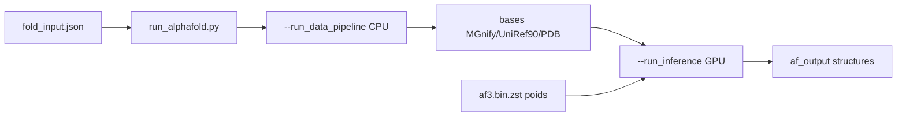

# google-deepmind/alphafold3

> AlphaFold 3 inference pipeline for predicting the structure of biomolecular interactions.

## The problem
Predicting the structure of a protein-ligand or protein-nucleic acid complex required separate methods and months of experimental work.

## What it actually does
Provides the complete AlphaFold 3 inference code; the weights are distributed separately.
Takes as input a JSON describing sequences, model seeds and dialect.
Separates two stages controllable by flags: `--run_data_pipeline` (genetic and template search, CPU only, slow) and `--run_inference` (GPU).
Runs through a Docker image mounting inputs, outputs, models and public databases.

## How it is wired


## Trying it
```bash
docker run -it \
    --volume $HOME/af_input:/root/af_input \
    --volume $HOME/af_output:/root/af_output \
    --gpus all \
    alphafold3 \
    python run_alphafold.py \
    --json_path=/root/af_input/fold_input.json \
    --model_dir=/root/models \
    --output_dir=/root/af_output
```

## Cost and gotchas
The code is Apache 2.0 but the model parameters are subject to separate terms and can only be used if obtained directly from Google. The data pipeline requires the mirrored databases, several hundred GB. A GPU is mandatory for inference.

## What it is not
Not clinically usable: the README explicitly states that the model and its outputs are neither validated nor approved for clinical use. Not free in the usual sense: the weights carry their own terms. Not training: only inference is provided.

## Alternatives
alphafoldserver.com — the hosted version, non-commercial, with fewer ligands and covalent modifications.

## For you
Worth knowing as a reference in the field; the required infrastructure reserves it for specialized bio use.
