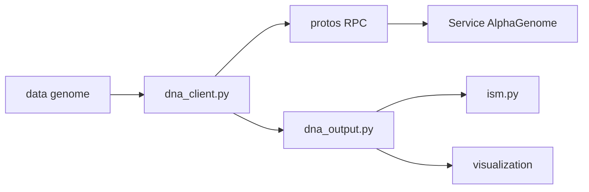

# google-deepmind/alphagenome

> Python client for the AlphaGenome API to predict the effect of variants in regulatory DNA, for genomics researchers.

## The problem
Predicting gene expression, splicing or chromatin from 1 Mbp DNA sequences, without training your own model.

## What it actually does
The repository contains neither weights nor training: it is a client SDK. Genomic objects (interval, variant, transcript, ontology), a `dna_client` client that calls the remote service over RPC (protobuf), variant scoring, in silico mutagenesis, matplotlib visualization and Colab notebooks. The API is free for non-commercial use.

## How it is wired


## Trying it
```bash
git clone https://github.com/google-deepmind/alphagenome.git
pip install ./alphagenome
```
```python
model = dna_client.create(API_KEY)
```

## Cost and gotchas
API key required, free for non-commercial use; quotas vary, unsuited to more than a million predictions. The outputs may not be used to train other models nor for clinical decisions. Commercial use goes through Google Cloud.

## What it is not
Not a local model: without the remote service, nothing runs. The code is Apache-2.0 but the outputs have restrictive terms of use.

## Alternatives
No alternative named in the README.

## For you
Worth watching: interesting for bioinformatics, but it depends on a service and forbids reusing the outputs for training.
