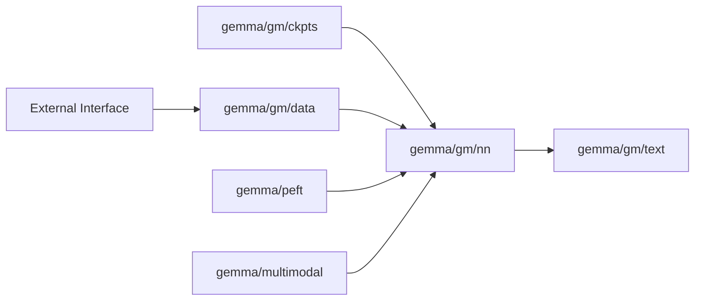

# google-deepmind/gemma

> Official JAX library to load, sample from and fine-tune Gemma models.

## The problem
Using and fine-tuning Gemma in JAX means rewriting checkpoint loading, tokenization and the sampling loop.

## What it actually does
`gemma` package: architectures (`gm.nn.Gemma4_E4B`...), checkpoint loading, multi-turn `ChatSampler`.
Same API for Gemma 2, 3, 3n and 4; multimodal inputs (images).
Fine-tuning, LoRA and quantization (`peft` module); colabs and example scripts.
Runs on CPU, GPU, TPU.

## How it is wired


## Trying it
```bash
pip install gemma
```
(install JAX for CPU/GPU/TPU beforehand)

## Cost and gotchas
Free; 8 GB of VRAM for the small models, 24 GB+ for the larger ones. Weights must be downloaded separately (Gemma terms).

## What it is not
Not an inference server nor a PyTorch lib: it is the JAX ecosystem. 331 open issues.

## Alternatives
No alternative named in the README (it refers to "other implementations" without naming them).

## For you
Keep an eye on it: the official path if you work in JAX/TPU; in PyTorch, the Hugging Face ecosystem remains more direct.
