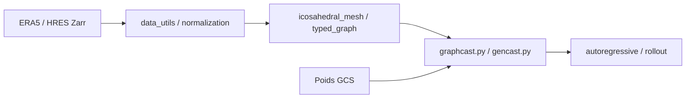

# google-deepmind/graphcast

> Code and weights of the WeatherNext weather models (WN2, GraphCast, GenCast) for forecasting weather and cyclones.

## The problem
Classic numerical forecasts are expensive; learned models can approximate them at lower cost.

## What it actually does
Provides the JAX code to run WeatherNext 2 and WeatherNext Cyclones (0.25°), a Mini version (1°), as well as GraphCast (deterministic, graph networks) and GenCast (diffusion ensembles). Colab notebook, weights on a Google Cloud bucket. Recommended on TPU; H100 for the large models, P100 for the Mini.

## How it is wired


## Trying it
```bash
pip install git+https://github.com/google-deepmind/weathernext.git@v0.3.0
```

## Cost and gotchas
Free but heavy hardware (TPU/H100). ERA5/HRES data under separate terms. "Research code, with no guarantee of API stability".

## What it is not
Not an official alert service: the README states that these models do not replace the advisories of weather agencies.

## Alternatives
Daily WN2 data feeds on Google Cloud, WeatherLab and OpenMeteo, cited by the README, if you do not want to run the model.

## For you
Keep an eye on it: a reference for weather AI and JAX, but hardware cost and research-grade code hinder direct use.
