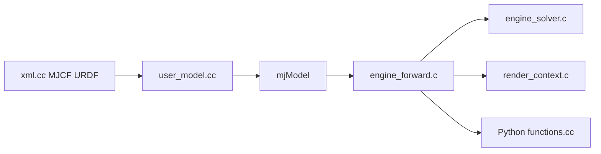

# google-deepmind/mujoco

> Physics engine for articulated bodies with contacts, for research in robotics, biomechanics and learning.

## The problem
Simulating articulated bodies in contact (robots, humanoids) quickly and precisely, in order to train or test control policies.

## What it actually does
A C/C++ library with a C API: an XML/MJCF compiler produces an immutable `mjModel`, then `mjData` evolves step by step (kinematics, collisions, constraints, solver). Provides a native `simulate` viewer, Python, JS/WASM, C#/Unity bindings, and MJX, a JAX variant for accelerators.

## How it is wired


## Trying it
```bash
pip install mujoco
```
Or a binary from the releases page, then launch `simulate`.

## Cost and gotchas
Free. Python ≥ 3.11 for the package. The `main` branch may be unstable: prefer the releases (monthly, early in the month). MJX requires JAX.

## What it is not
Not a reinforcement learning framework: it provides the physics, the environments come from dm_control or others. Low-level C API, no rich editing GUI.

## Alternatives
dm_control (Google DeepMind environments). Third-party bindings (Julia, Rust, MATLAB Simulink) if your language is not Python.

## For you
Adopt if you do robotics or RL on simulation: Apache-2.0, maintained by DeepMind, Colab notebooks to get started.
