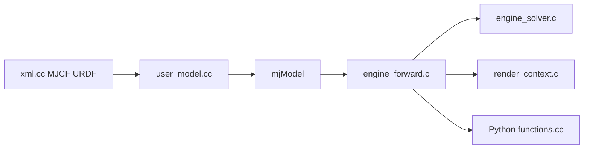

# google-deepmind/mujoco

> Moteur physique d'articulations avec contacts, pour la recherche en robotique, biomécanique et apprentissage.

## Le problème
Simuler des corps articulés en contact (robots, humanoïdes) vite et précisément, pour entraîner ou tester des politiques de contrôle.

## Ce que ça fait vraiment
Bibliothèque C/C++ à API C : un compilateur XML/MJCF produit un `mjModel` immuable, puis `mjData` évolue pas à pas (cinématique, collisions, contraintes, solveur). Fournit un viewer natif `simulate`, des bindings Python, JS/WASM, C#/Unity, et MJX, variante JAX pour l'accélérateur.

## Comment c'est branché


## Essayer
```bash
pip install mujoco
```
Ou binaire depuis la page releases, puis lancer `simulate`.

## Coût et pièges
Gratuit. Python ≥ 3.11 pour le paquet. La branche `main` peut être instable : préférer les releases (mensuelles, début de mois). MJX demande JAX.

## Ce que ce n'est pas
Pas un framework d'apprentissage par renforcement : il fournit la physique, les environnements viennent de dm_control ou autres. API C bas niveau, pas de GUI d'édition riche.

## Alternatives
dm_control (environnements Google DeepMind). Bindings tiers (Julia, Rust, MATLAB Simulink) si ton langage n'est pas Python.

## Pour toi
Adopter si tu fais de la robotique ou du RL sur simulation : Apache-2.0, maintenu par DeepMind, notebooks Colab pour démarrer.

