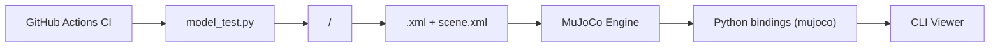

# google-deepmind/mujoco_menagerie

> Collection of validated robot models for the MuJoCo physics simulator, for robotics and RL researchers.

## The problem
A simulator is only useful if its models behave correctly. Writing a faithful MJCF file for an arm, a quadruped or a hand takes a lot of tuning.

## What it actually does
Each robot has its own folder: meshes (`assets/`), MJCF definition (`<model>.xml`), `scene.xml` (floor, light), an image and sometimes MJX variants. The catalogue covers humanoids, quadrupeds, bipeds, arms, hands and drones. A Python package `mujoco-menagerie` downloads a model on demand. CI validates the XML files and runs the tests (`model_test.py`, `mjx_model_test.py`); `generate_gallery.py` produces the thumbnails.

## How it is wired


## Trying it
```bash
git clone https://github.com/google-deepmind/mujoco_menagerie.git
python -m mujoco.viewer --mjcf mujoco_menagerie/unitree_go2/scene.xml
pip install mujoco-menagerie
uvx mujoco-menagerie view unitree_go2
```

## Cost and gotchas
Free. Each model has its own license (BSD-3-Clause, Apache-2.0, MIT, BSD-2-Clause, BSD-3-Clause-Clear): the repository's license is not identified by GitHub, so check model by model. The minimum MuJoCo version is specified in each model's README.

## What it is not
It is not a simulator: you need MuJoCo. These are not trained control policies, only physical descriptions. Not all models have an MJX (GPU) variant.

## Alternatives
- `robot_descriptions`: third-party package cited by the README for loading the same models.

## For you
Worth watching: of no interest outside robotics or reinforcement learning, but if you simulate a robot under MuJoCo or MJX, it is the starting point maintained by DeepMind, licenses to be checked.
