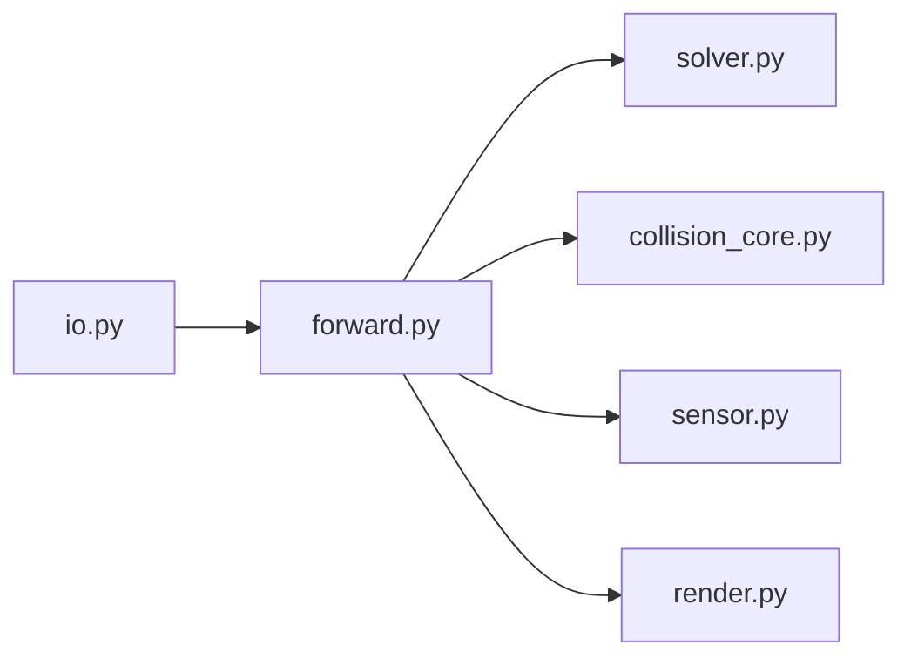

# google-deepmind/mujoco_warp

> GPU version of MuJoCo (NVIDIA Warp) for massively parallel simulation in robotics research.

## The problem
Training robotics policies by learning requires thousands of parallel simulations that CPU MuJoCo handles poorly.

## What it actually does
Reuses the MuJoCo API and models with Warp kernels: dynamics, constraint solver, collisions (primitives, SDF), sensors, ray queries and batched rendering (meshes, textures, Gaussian splats). Can be integrated via MJX/JAX, Isaac Lab (via Newton) or mjlab (PyTorch). Maintained by Google DeepMind and NVIDIA.

## How it is wired


## Trying it
```bash
git clone https://github.com/google-deepmind/mujoco_warp.git && cd mujoco_warp
python benchmarks/run.py -f unitree_g1_flat --view
pip install mujoco-warp
mjwarp-testspeed benchmarks/humanoid/humanoid.xml --event_trace
```

## Cost and gotchas
NVIDIA GPU recommended; the CPU is for development. No differentiability through Warp for now.

## What it is not
Not a full equivalent of MuJoCo: the `IMPLICITFAST` integrator, the PGS and noslip solvers, and plugins are not supported, and Flex remains experimental.

## Alternatives
- MJX (JAX): the JAX route cited in the README.
- Isaac Lab and mjlab: PyTorch integrations cited.

## For you
Adopt it if you do reinforcement learning in robotics with an NVIDIA GPU: backed by DeepMind and NVIDIA, active and documented.
