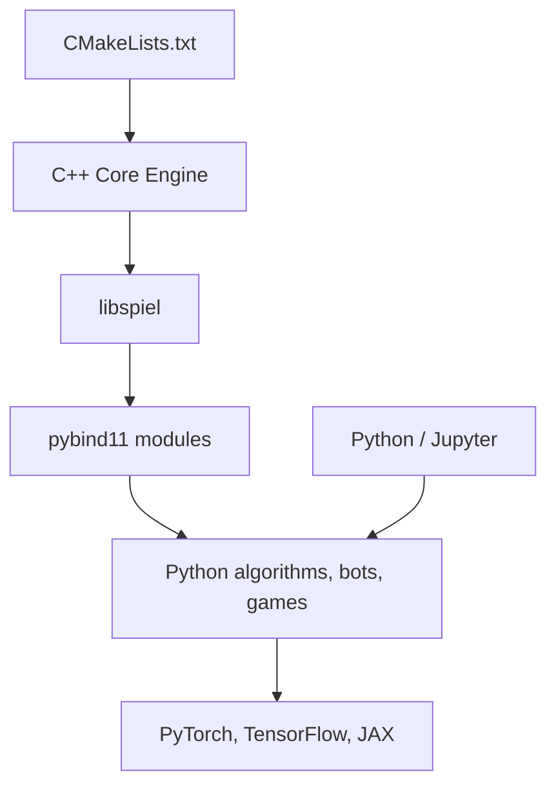

# google-deepmind/open_spiel

> Game environments and reinforcement learning and search algorithms, for AI researchers.

## The problem
Comparing multi-agent RL or game theory algorithms requires homogeneous games and metrics, rarely available together.

## What it actually does
A C++ core exposes a common game API (turn-based or simultaneous, perfect or imperfect information, 1 to n players) through pybind11. Algorithms and tools are written in C++ and Python, with JAX, PyTorch and TensorFlow variants. Julia, Rust and Go bindings exist. Checkpoints and datasets are published on `gs://openspiel-data`.

## How it is wired

## Trying it
The README contains no command: installation and the starter example are deferred to linked pages (docs/install, colabs). Not documented here.

## Cost and gotchas
Free. C++ compilation (CMake) is needed outside the wheel; installation is described separately for Linux/macOS and Windows.

## What it is not
Not a mainstream game engine nor a benchmark for LLMs. It is a research framework for RL and planning in games.

## Alternatives
No alternative named in the README.

## For you
Adopt it if you do multi-agent RL or game theory: reference framework maintained by DeepMind, with colabs and a paper to cite.
