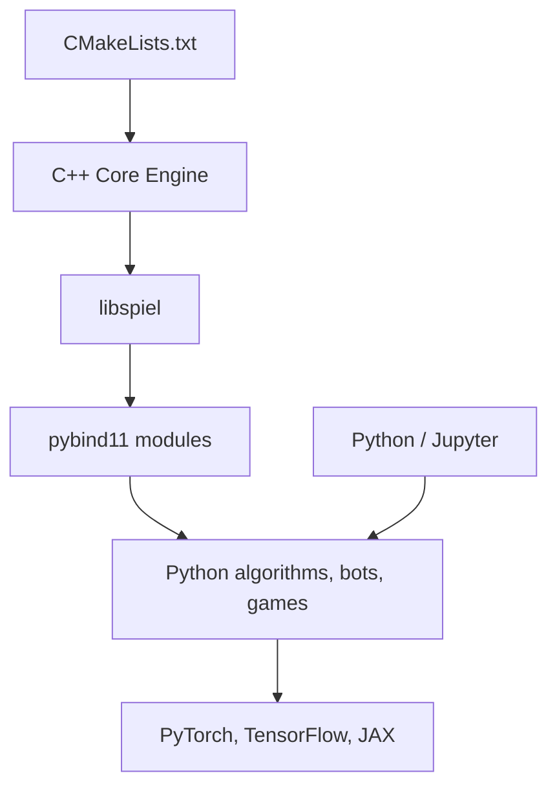

# google-deepmind/open_spiel

> Environnements de jeux et algorithmes d'apprentissage par renforcement et de recherche, pour chercheurs en IA.

## Le problème
Comparer des algorithmes de RL multi-agents ou de théorie des jeux exige des jeux et des métriques homogènes, rarement disponibles ensemble.

## Ce que ça fait vraiment
Un cœur C++ expose une API commune de jeux (tour par tour ou simultanés, information parfaite ou imparfaite, 1 à n joueurs) via pybind11. Algorithmes et outils sont écrits en C++ et en Python, avec des variantes JAX, PyTorch et TensorFlow. Des liaisons Julia, Rust et Go existent. Des points de contrôle et jeux de données sont publiés sur `gs://openspiel-data`.

## Comment c'est branché

## Essayer
Le README ne contient pas de commande : l'installation et l'exemple de départ sont renvoyés vers des pages liées (docs/install, colabs). Non documenté ici.

## Coût et pièges
Gratuit. Compilation C++ (CMake) nécessaire hors wheel ; installation décrite séparément pour Linux/macOS et Windows.

## Ce que ce n'est pas
Pas un moteur de jeu grand public ni un banc d'essai pour LLM. C'est un cadre de recherche en RL et planification dans les jeux.

## Alternatives
Aucune alternative nommée dans le README.

## Pour toi
À adopter si tu fais du RL multi-agents ou de la théorie des jeux : cadre de référence maintenu par DeepMind, avec colabs et papier à citer.

