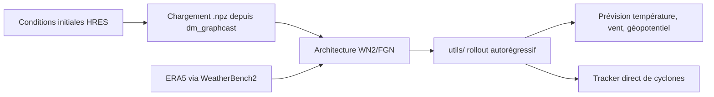

# google-deepmind/weathernext

> Code and weights of DeepMind's medium-range weather and cyclone forecasting models.

## The problem
Reproducing an AI weather forecast requires published weights, a cyclone tracker and an autoregressive rollout pipeline, which are rarely available together.

## What it actually does
Hosts WeatherNext 2, a global atmospheric and cyclone model at 0.25° (~30 km), plus the earlier generations GraphCast and GenCast. Several sets of weights: the operational version initialized on ECMWF HRES conditions, the Cyclones variants that reproduce the paper's results by year, and Mini versions at 1° for modest hardware. The `utils/` directory provides the autoregressive rollout, normalization, graph blocks, the loss and JAX-compatible xarray utilities.

## How it is wired


## Trying it
```bash
pip install git+https://github.com/google-deepmind/weathernext.git@v0.3.0
```

## Cost and gotchas
The code is free, the hardware is not: the non-Mini models require an H100 for VRAM; the Minis run on a P100 or a free Colab `v5e-1` runtime. Optimized for TPU: on GPU you must change the attention implementation. Full training requires downloading ERA5, and those datasets have their own terms of use to check.

## What it is not
Explicitly "not an officially supported Google product", research code provided as is, with no API stability guarantee, hence the recommendation to pin a version. Neither replaces nor is endorsed by a meteorological agency: not an official alert source.

## Alternatives
- **Google Cloud / WeatherLab / OpenMeteo**: daily data feeds, if you do not want to run the model.

## For you
Interesting as a textbook case of a geospatial model; heavy to operate outside a weather context.
