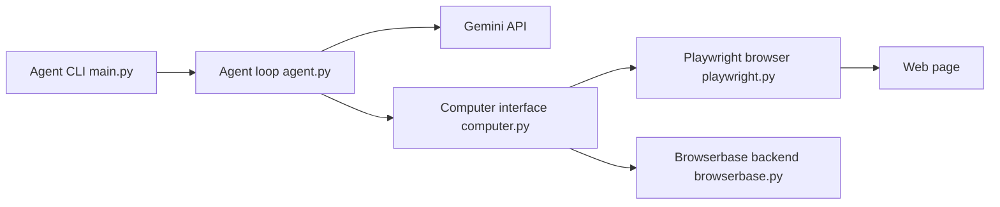

# google-gemini/computer-use-preview

> Demo CLI agent that drives a browser with Gemini (computer use) via Playwright or Browserbase.

## The problem
Testing Gemini's ability to act on web pages requires wiring together the model, screenshots and a browser.

## What it actually does
`main.py` takes a natural-language request. The agent loop asks Gemini for actions, runs them in a browser (local Chrome via Playwright or a remote Browserbase session), then sends the page state back to the model. Models: `gemini-3.6-flash` by default, or other variants. Gemini Developer API or Vertex AI.

## How it is wired


## Trying it
```bash
git clone https://github.com/google-gemini/computer-use-preview.git
cd computer-use-preview
python3 -m venv .venv
source .venv/bin/activate
pip install -r requirements.txt
playwright install chrome
export GEMINI_API_KEY="YOUR_GEMINI_API_KEY"
python main.py --query "Go to Google and type 'Hello World' into the search bar" --env="playwright"
```

## Cost and gotchas
Gemini key is billed; Browserbase requires a key and a project. Known issue: native dropdown lists are not captured by Playwright on some OSes.

## What it is not
A demo "preview", not a product: no security guarantee for acting on real sites.

## Alternatives
- Browserbase: remote browser backend already supported.

## For you
Worth watching: a good reference example for understanding a computer-use loop, not to be run on sensitive accounts.
