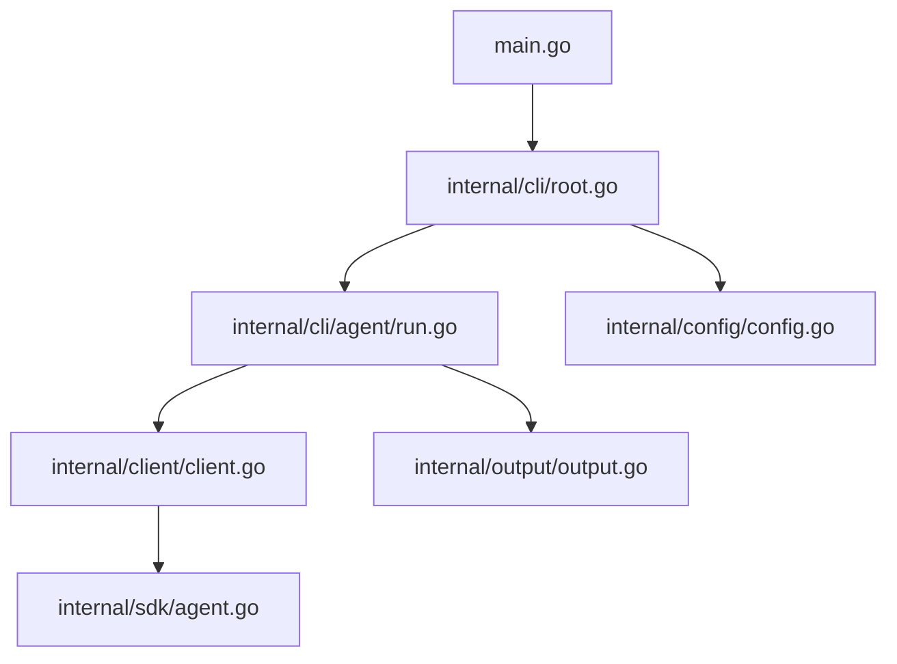

# google-gemini/gemini-api-cli

> Stateless CLI that gives any command-line agent access to Gemini models and managed agents.

## The problem
A coding agent sometimes needs an image, a voice, a transcription or a delegated search, without a custom Gemini integration.

## What it actually does
A single Go binary with `generate`, `image`, `tts`, `music`, `video`, `analyze`, `transcribe`, `agent`, `files`, `models` commands. Media is written to disk and the path is returned. `--dry-run`, `--schema`, `--usage` and JSON or TOON outputs make the tool readable by an agent. The key is read from an environment variable, keychain or config file.

## How it is wired



## Trying it
```bash
curl -fsSL https://raw.githubusercontent.com/google-gemini/gemini-api-cli/main/scripts/install.sh | bash
export GEMINI_API_KEY="YOUR_API_KEY"
gemini-api generate "Hello from my agent" --dry-run
gemini-api image "A friendly robot mascot for a developer tool" --out ./assets/
```

## Cost and gotchas
Calls are billed through your Gemini key. Beta: breaking changes are possible, the README advises pinning a version. No pull requests are accepted.

## What it is not
Not an agent: it provides tools to your agent. Not a local client: everything goes through the Gemini API.

## Alternatives
No alternative named in the README.

## For you
Watch: handy for giving an agent Gemini multimodal capabilities, but beta, tied to Google and closed to external contributions.
