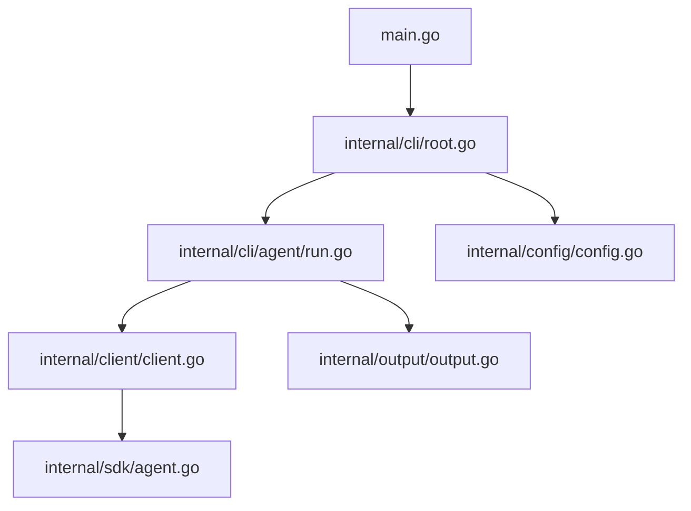

# google-gemini/gemini-api-cli

> CLI sans état qui donne à tout agent en ligne de commande l'accès aux modèles et agents gérés Gemini.

## Le problème
Un agent de code a parfois besoin d'une image, d'une voix, d'une transcription ou d'une recherche déléguée, sans intégration Gemini sur mesure.

## Ce que ça fait vraiment
Un binaire Go unique avec des commandes `generate`, `image`, `tts`, `music`, `video`, `analyze`, `transcribe`, `agent`, `files`, `models`. Les médias sont écrits sur disque et le chemin est renvoyé. `--dry-run`, `--schema`, `--usage` et des sorties JSON ou TOON rendent l'outil lisible par un agent. La clé est lue via variable d'environnement, trousseau ou fichier de config.

## Comment c'est branché



## Essayer
```bash
curl -fsSL https://raw.githubusercontent.com/google-gemini/gemini-api-cli/main/scripts/install.sh | bash
export GEMINI_API_KEY="YOUR_API_KEY"
gemini-api generate "Hello from my agent" --dry-run
gemini-api image "A friendly robot mascot for a developer tool" --out ./assets/
```

## Coût et pièges
Les appels sont facturés via ta clé Gemini. Bêta : des ruptures sont possibles, le README conseille d'épingler une version. Aucune pull request n'est acceptée.

## Ce que ce n'est pas
Pas un agent : il fournit des outils à ton agent. Pas un client local : tout passe par l'API Gemini.

## Alternatives
Aucune alternative nommée dans le README.

## Pour toi
À surveiller : pratique pour donner du multimodal Gemini à un agent, mais bêta, liée à Google et sans contributions externes.

