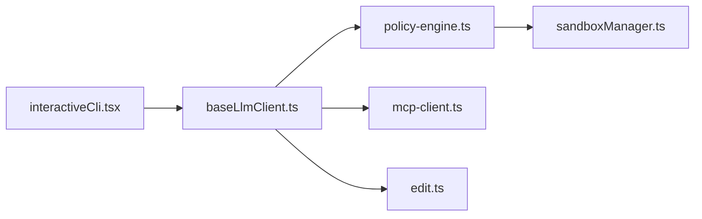

# google-gemini/gemini-cli

> Online command-line agent that brings Gemini into the terminal; replaced by Antigravity CLI for the free offering.

## The problem
To query, modify, and debug a codebase from the terminal without leaving the shell.

## What it actually does
An interactive or scriptable agent (`-p`, JSON output or event stream). It queries the model via a dedicated client, applies a tool policy, a command sandbox, file editing, MCP servers, and skills. GEMINI.md context files, checkpoints, token cache. A separate A2A server exists. Authentication is via a Google account, a Gemini key, or Vertex AI.

## How it is wired


## Trying it
```bash
npx @google/gemini-cli
npm install -g @google/gemini-cli
gemini -p "Explain the architecture of this codebase"
```

## Cost and gotchas
API key or Google account. The README states that the free offering has been replaced by Antigravity CLI as of June 18, 2026, and that the tool is not optimized for the latest models. The authentication section in the provided README is incomplete.

## What it is not
The recommended tool, provided by the manufacturer itself, for the latest Gemini models. This tool is not independent of a specific model provider.

## Alternatives
Antigravity CLI, as indicated in the README, is the currently recommended option.

## For you
Things to watch out for: its own page is moving towards Antigravity, so don't build anything permanent on it without confirming the future of the project.
