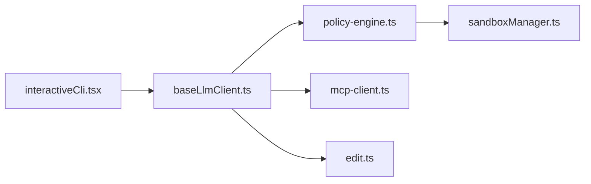

# google-gemini/gemini-cli

> Agent IA en ligne de commande qui apporte Gemini dans le terminal ; remplacé par Antigravity CLI pour l'offre gratuite.

## Le problème
Interroger, modifier et déboguer une base de code depuis le terminal sans quitter le shell.

## Ce que ça fait vraiment
Un agent interactif ou scriptable (`-p`, sortie JSON ou flux d'événements). Il interroge le modèle via un client dédié, applique une politique d'outils, un bac à sable de commandes, l'édition de fichiers, des serveurs MCP et des skills. Fichiers de contexte GEMINI.md, points de contrôle, cache de jetons. Un serveur A2A séparé existe. Authentification par compte Google, clé Gemini ou Vertex AI.

## Comment c'est branché


## Essayer
```bash
npx @google/gemini-cli
npm install -g @google/gemini-cli
gemini -p "Explain the architecture of this codebase"
```

## Coût et pièges
Clé d'API ou compte Google. Le README annonce que l'offre gratuite a été remplacée par Antigravity CLI le 18 juin 2026 et que l'outil n'est pas optimisé pour les derniers modèles. Section d'authentification tronquée dans le README fourni.

## Ce que ce n'est pas
Plus l'outil recommandé par son propre éditeur pour les derniers modèles Gemini. Pas indépendant d'un fournisseur de modèle.

## Alternatives
Antigravity CLI, désigné par le README comme le choix actuel.

## Pour toi
À surveiller : sa propre page pousse vers Antigravity, donc ne bâtis rien de durable dessus sans confirmer l'avenir du projet.

