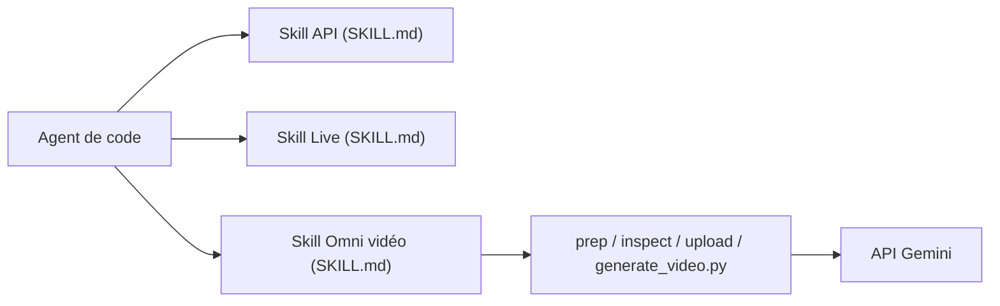

# google-gemini/gemini-skills

> Library of skills for coding agents that know the up-to-date Gemini APIs: SDKs, Live API, video.

## The problem
LLMs have frozen knowledge and are unaware of new models, SDKs and best practices of the Gemini APIs.

## What it actually does
Three skills: `gemini-api-dev` (text, chat, streaming, function calling, structured output, images, managed agents, Deep Research, Python and TypeScript SDKs), `gemini-live-api-dev` (bidirectional audio/video/text streams over WebSocket) and `gemini-omni-flash-api` (video generation and editing with preparation, inspection, upload and generation scripts). The authors' evaluations report 87% correct code with Gemini 3 Flash and 96% with Gemini 3.1 Pro.

## How it is wired


## Trying it
```bash
npx skills add google-gemini/gemini-skills --list
npx skills add google-gemini/gemini-skills --skill gemini-api-dev
/plugin marketplace add google-gemini/gemini-skills
```

## Cost and gotchas
The skills are free; Gemini API usage is at your expense. The evaluation figures come from Google. The Vertex AI skill has been moved to another path.

## What it is not
Not an SDK nor an officially supported product: the repository says so itself. These are instructions for agents, not execution logic.

## Alternatives
Not documented in the README: no alternative named.

## For you
Worth watching if you code with Gemini through an agent: cheap to try and useful against outdated APIs; without Gemini in your stack, you have no use for it.
