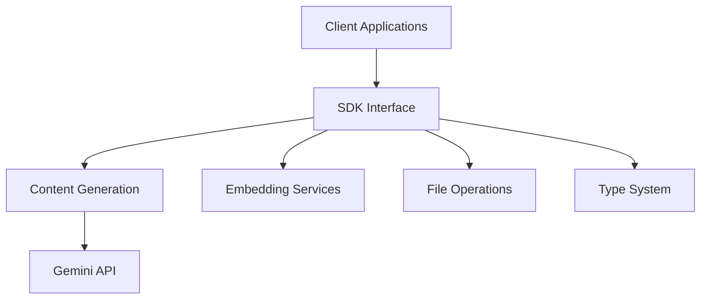

# google-gemini/generative-ai-python

> Former Python SDK for the Gemini API, now replaced by the unified Google Gen AI SDK.

## The problem
Calling the Gemini models from Python.

## What it actually does
The README contains only the deprecation notice: maintenance limited to critical fixes, end of all support on November 30, 2025, and a pointer to a migration guide. The diagram mentions GenerativeModel, chat sessions, embeddings, files, cache.

## How it is wired

## Trying it
No command documented in the README (pointer to the migration guide).

## Cost and gotchas
Gemini API key. The catalog says "archived: no" despite the announced end of support.

## What it is not
Not an SDK to adopt today: it is end of life.

## Alternatives
- Google Gen AI SDK: unified successor cited in the README (repository name not given).

## For you
Ignore: support has ended, migrate to the Google Gen AI SDK if you still use this package.
