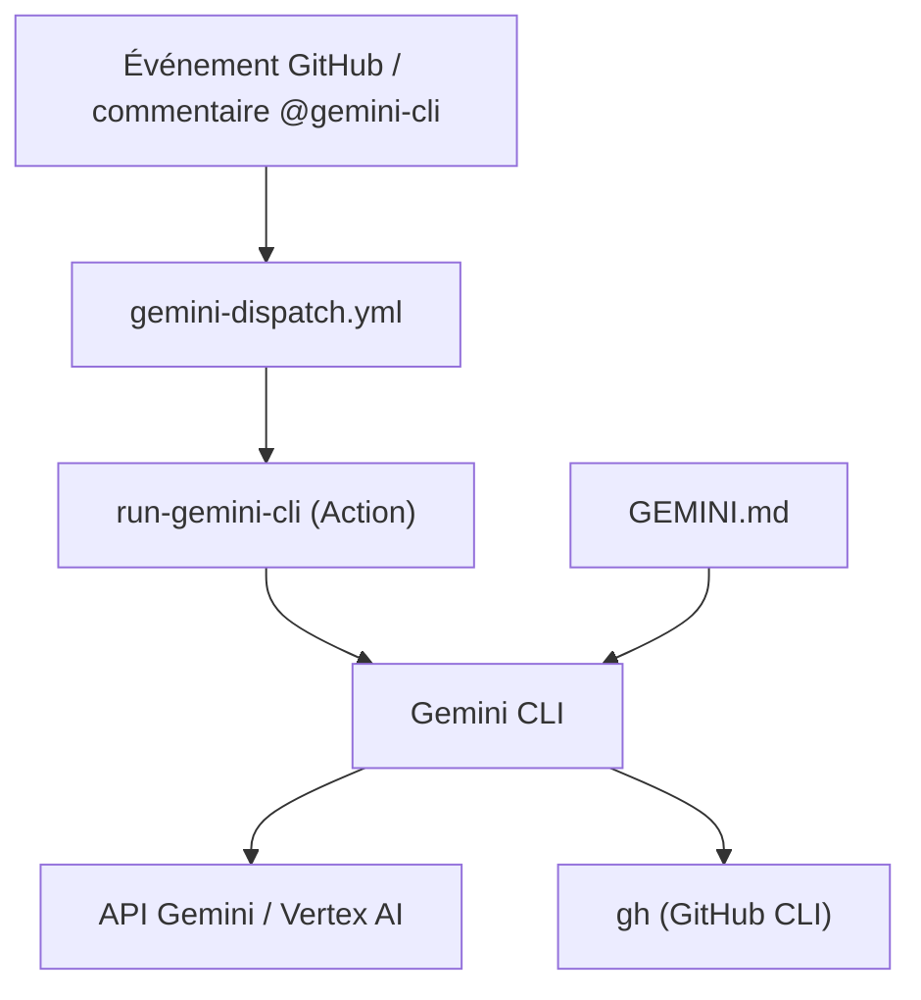

# google-github-actions/run-gemini-cli

> GitHub Action that runs Gemini CLI to review PRs, triage issues and reply to comments.

## The problem
Reviewing pull requests and triaging issues by hand wastes time; delegating to an agent in comments requires an integration you have to write.

## What it actually does
The action installs Gemini CLI in a workflow and runs a prompt. It provides ready-to-copy workflows: central dispatch, issue triage, PR review and a conversational assistant (`@gemini-cli /review`). A `GEMINI.md` file provides the project context. Authentication goes through an API key or Google identity federation, and GitHub through a token or a dedicated app.

## How it is wired
Simplified diagram based on the sheet, no diagram provided.



## Trying it
```bash
gemini
# puis, dans Gemini CLI :
/setup-github
```

## Cost and gotchas
A Gemini API key (`GEMINI_API_KEY` secret) or a Google Cloud project is required. API calls and Actions minutes are at your expense, beyond the announced free quotas. The README recommends pinning versions and protecting branches; do not set the `DEBUG` variable, which blocks the CLI.

## What it is not
It is not a model or a standalone service: it is an action that runs Gemini CLI in your workflows. The agent acts on your repository with the rights of the token provided.

## Alternatives
No alternative named in the README.

## For you
Worth watching if your repositories are on GitHub: automating review and triage is concrete, but it ties you to Gemini and its quotas.
