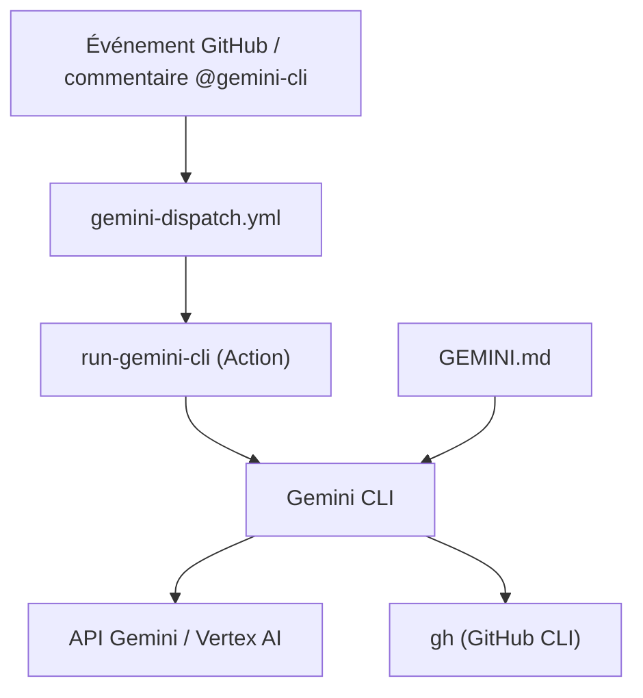

# google-github-actions/run-gemini-cli

> GitHub Action qui lance Gemini CLI pour relire des PR, trier des issues et répondre à des commentaires.

## Le problème
Relire les pull requests et trier les issues à la main use du temps ; déléguer à un agent dans les commentaires demande une intégration à écrire.

## Ce que ça fait vraiment
L'action installe Gemini CLI dans un workflow et exécute un prompt. Elle fournit des workflows prêts à copier : dispatch central, triage d'issues, revue de PR et assistant conversationnel (`@gemini-cli /review`). Un fichier `GEMINI.md` fournit le contexte du projet. L'authentification passe par une clé d'API ou par la fédération d'identité Google, et GitHub par un jeton ou une application dédiée.

## Comment c'est branché
Schéma simplifié d'après la fiche, sans diagramme fourni.



## Essayer
```bash
gemini
# puis, dans Gemini CLI :
/setup-github
```

## Coût et pièges
Il faut une clé d'API Gemini (secret `GEMINI_API_KEY`) ou un projet Google Cloud. Les appels et minutes d'Actions sont à ta charge, au-delà des quotas gratuits annoncés. Le README recommande d'épingler les versions et de protéger les branches ; ne pas définir la variable `DEBUG`, qui bloque la CLI.

## Ce que ce n'est pas
Ce n'est pas un modèle ni un service autonome : c'est une action qui exécute Gemini CLI dans tes workflows. L'agent agit sur ton dépôt avec les droits du jeton fourni.

## Alternatives
Aucune alternative nommée dans le README.

## Pour toi
À surveiller si tes dépôts sont sur GitHub : l'automatisation de la revue et du triage est concrète, mais elle t'attache à Gemini et à ses quotas.

