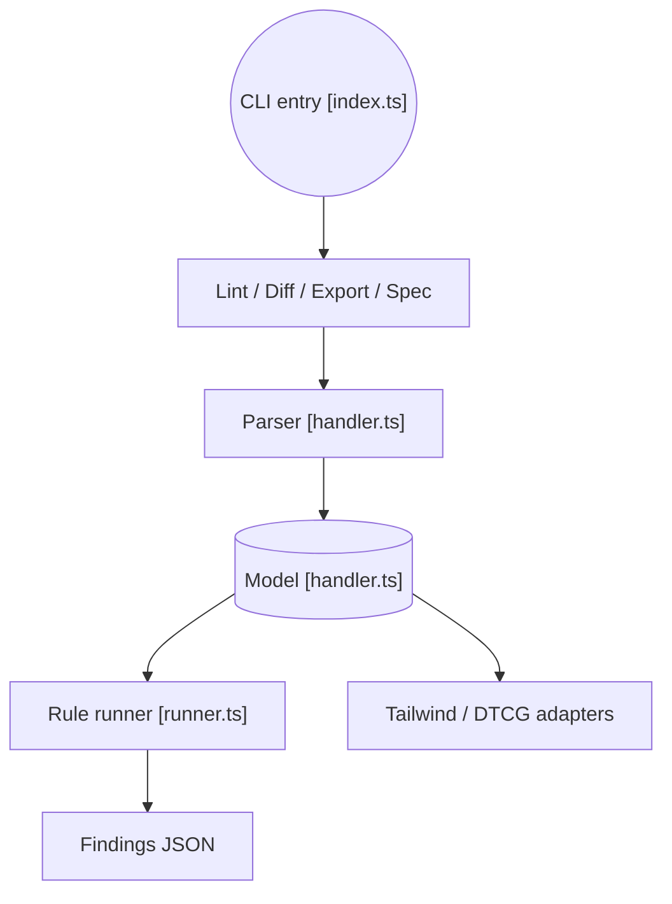

# google-labs-code/design.md

> File format and CLI for describing a visual identity to coding agents, with lint, diff and export.

## The problem
Agents that write interfaces have no persistent, verifiable description of the design system.

## What it actually does
A DESIGN.md file combines design tokens in YAML (colors, typography, spacing, components) and rationale in Markdown. The CLI does `lint` (broken references, WCAG contrast), `diff` (regressions between two versions), `export` (Tailwind v3 and v4, DTCG) and `spec`. The format is at version `alpha`.

## How it is wired


## Trying it
```bash
npx @google/design.md lint DESIGN.md
npx @google/design.md diff DESIGN.md DESIGN-v2.md
npx @google/design.md export --format css-tailwind DESIGN.md > theme.css
npx @google/design.md spec
```

## Cost and gotchas
Free. On Windows PowerShell, use the `designmd` alias with `npx -p @google/design.md designmd`. The format may change.

## What it is not
Not an interface generator or a service: a format and a validator for local files. The project is not eligible for Google's security rewards program.

## Alternatives
None named in the README.

## For you
Keep an eye on it: useful if your agents produce interfaces, of little relevance for pure data work as long as the format stays in alpha.
