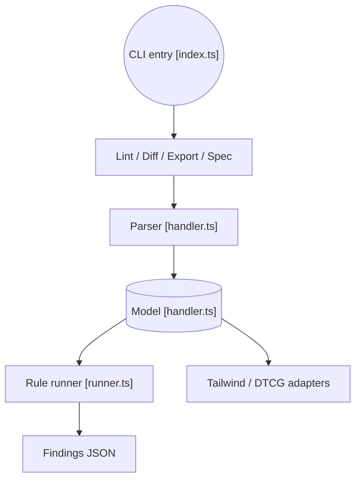

# google-labs-code/design.md

> Format de fichier et CLI pour décrire une identité visuelle à des agents de code, avec lint, diff et export.

## Le problème
Les agents qui écrivent des interfaces n'ont pas de description persistante et vérifiable du système de design.

## Ce que ça fait vraiment
Un fichier DESIGN.md combine jetons de design en YAML (couleurs, typographie, espacements, composants) et justification en Markdown. Le CLI fait `lint` (références cassées, contraste WCAG), `diff` (régressions entre deux versions), `export` (Tailwind v3 et v4, DTCG) et `spec`. Le format est en version `alpha`.

## Comment c'est branché


## Essayer
```bash
npx @google/design.md lint DESIGN.md
npx @google/design.md diff DESIGN.md DESIGN-v2.md
npx @google/design.md export --format css-tailwind DESIGN.md > theme.css
npx @google/design.md spec
```

## Coût et pièges
Gratuit. Sous Windows PowerShell, utiliser l'alias `designmd` avec `npx -p @google/design.md designmd`. Le format peut changer.

## Ce que ce n'est pas
Pas un générateur d'interfaces ni un service : un format et un validateur de fichiers locaux. Le projet n'est pas éligible au programme de récompenses de sécurité de Google.

## Alternatives
Aucune nommée dans le README.

## Pour toi
À surveiller : utile si tes agents produisent des interfaces, peu pertinent pour du travail data pur tant que le format reste en alpha.

