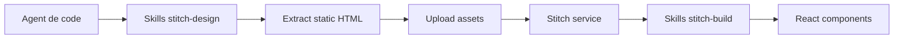

# google-labs-code/stitch-skills

> Collection of agent skills for designing and exporting interfaces with Google Stitch.

## The problem
Going from front-end code to a Stitch design, then from design to components, requires repetitive manual steps.

## What it actually does
Three plugins: `stitch-design` (code to design, generation, design system), `stitch-build` (React, React Native, Vite, Remotion video, shadcn) and `stitch-utilities` (DESIGN.md, prompt improvement, multi-page loop). Each skill follows the Agent Skills standard (`SKILL.md`, scripts, resources).

## How it is wired


## Trying it
```bash
npx plugins add google-labs-code/stitch-skills --scope project --target claude-code
npx skills add google-labs-code/stitch-skills
npx skills --help
```

## Cost and gotchas
Requires the Stitch MCP server to be configured (credentials to provide) and a Stitch account. The skills have cross-dependencies: a partial installation may break. OpenCode requires a manual rename.

## What it is not
"Not an officially supported Google product", outside the vulnerability reward program. Useless without Stitch.

## Alternatives
None named in the README.

## For you
Worth watching: useful only if you do UI design with Stitch; little relevance to data/MLOps work.
