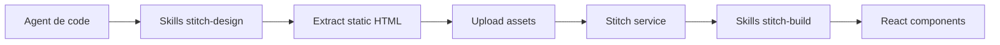

# google-labs-code/stitch-skills

> Collection de skills d'agents pour concevoir et exporter des interfaces avec Google Stitch.

## Le problème
Passer du code front à un design Stitch, puis du design à des composants, demande des étapes manuelles répétitives.

## Ce que ça fait vraiment
Trois plugins : `stitch-design` (code vers design, génération, système de design), `stitch-build` (React, React Native, Vite, vidéo Remotion, shadcn) et `stitch-utilities` (DESIGN.md, amélioration de prompts, boucle multi-pages). Chaque skill suit le standard Agent Skills (`SKILL.md`, scripts, ressources).

## Comment c'est branché


## Essayer
```bash
npx plugins add google-labs-code/stitch-skills --scope project --target claude-code
npx skills add google-labs-code/stitch-skills
npx skills --help
```

## Coût et pièges
Nécessite le serveur MCP Stitch configuré (identifiants à fournir) et un compte Stitch. Les skills ont des dépendances croisées : une installation partielle peut casser. OpenCode demande un renommage manuel.

## Ce que ce n'est pas
« Pas un produit Google officiellement supporté », hors programme de récompenses de vulnérabilités. Inutile sans Stitch.

## Alternatives
Aucune nommée dans le README.

## Pour toi
À surveiller : utile seulement si tu fais du design UI avec Stitch ; peu de rapport avec un travail data/MLOps.

