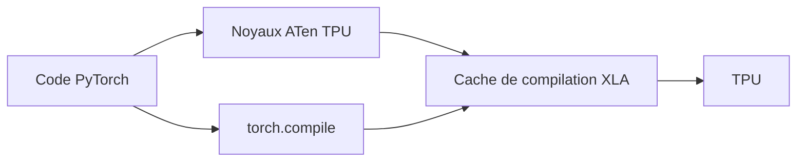

# google-pytorch/torch_tpu

> PyTorch backend for Google TPUs, aimed at anyone who wants to train or serve models on them.

## The problem
Using TPUs with PyTorch goes through indirect compatibility layers.

## What it actually does
Provides ATen kernels for TPU, a compilation cache for XLA computations, data and tensor parallelism, and integration with `torch.compile()`. Examples cover Llama, Qwen, ResNet, DLRM, minGPT and UNet. Marimo notebooks are launched from a TPU VM.

## How it is wired
Simplified diagram based on the sheet, no diagram provided.


## Trying it
```bash
python -m venv .venv
source .venv/bin/activate
pip install torch_tpu==0.2.0 --extra-index-url https://download.pytorch.org/whl/cpu
```

## Cost and gotchas
TPU hardware required (a GCE v6e VM is the simplest), so billed by Google Cloud. Python 3.11 to 3.15. Compilation goes through Bazel and can exceed 30 minutes. The license is not identified by GitHub.

## What it is not
It cannot be used on your local machine without a TPU. The dependencies section says "TBD".

## Alternatives
Not documented in the README.

## For you
Watch: interesting if your training or inference runs on TPU, but version 0.2.0, the license to be confirmed and the hardware cost suggest waiting.
