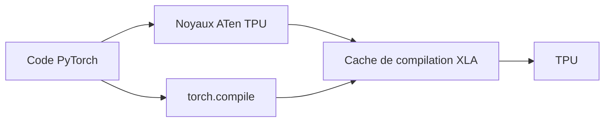

# google-pytorch/torch_tpu

> Backend PyTorch pour les TPU de Google, destiné à qui veut entraîner ou servir des modèles dessus.

## Le problème
Utiliser des TPU avec PyTorch passe par des couches de compatibilité indirectes.

## Ce que ça fait vraiment
Fournit des noyaux ATen pour TPU, un cache de compilation pour les calculs XLA, le parallélisme de données et de tenseurs, et l'intégration avec `torch.compile()`. Des exemples couvrent Llama, Qwen, ResNet, DLRM, minGPT et UNet. Les notebooks Marimo se lancent depuis une VM TPU.

## Comment c'est branché
Schéma simplifié d'après la fiche, sans diagramme fourni.


## Essayer
```bash
python -m venv .venv
source .venv/bin/activate
pip install torch_tpu==0.2.0 --extra-index-url https://download.pytorch.org/whl/cpu
```

## Coût et pièges
Matériel TPU requis (une VM GCE v6e est la plus simple), donc facturé chez Google Cloud. Python 3.11 à 3.15. La compilation passe par Bazel et peut dépasser 30 minutes. La licence n'est pas identifiée par GitHub.

## Ce que ce n'est pas
Ce n'est pas utilisable sur ta machine locale sans TPU. La section des dépendances indique « TBD ».

## Alternatives
Non documenté dans le README.

## Pour toi
À surveiller : intéressant si ton entraînement ou ton inférence tourne sur TPU, mais la version 0.2.0, la licence à confirmer et le coût du matériel invitent à attendre.

