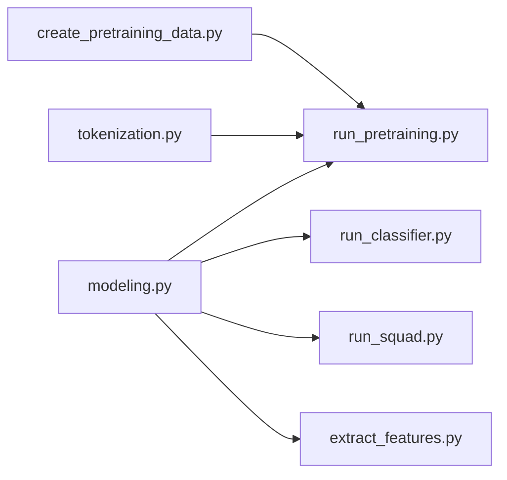

# google-research/bert

> TensorFlow 1 code and original BERT weights, for historical reference in NLP.

## The problem
In 2018, there was no reusable pre-trained bidirectional encoder for NLP tasks.

## What it actually does
`modeling.py` defines the Transformer, `tokenization.py` the WordPiece, `create_pretraining_data.py` + `run_pretraining.py` the pre-training (masked LM, next sentence), `run_classifier.py` and `run_squad.py` the fine-tuning, `extract_features.py` the embeddings. Base, Large, multilingual and Chinese weights, and 24 small models.

## How it is wired


## Trying it
```bash
python run_classifier.py --task_name=MRPC --do_train=true --do_eval=true --data_dir=$GLUE_DIR/MRPC --vocab_file=$BERT_BASE_DIR/vocab.txt --bert_config_file=$BERT_BASE_DIR/bert_config.json --init_checkpoint=$BERT_BASE_DIR/bert_model.ckpt --max_seq_length=128 --train_batch_size=32 --learning_rate=2e-5 --num_train_epochs=3.0 --output_dir=/tmp/mrpc_output/
```

## Cost and gotchas
Tested with TensorFlow 1.11; BERT-Large does not fit on a 12-16 GB GPU. Single-GPU only.

## What it is not
Not a modern base: archived, TF1, no official PyTorch.

## Alternatives
- HuggingFace PyTorch version, cited by the README, compatible with the checkpoints.

## For you
Historical reading only; in practice, go through the HuggingFace ecosystem.
