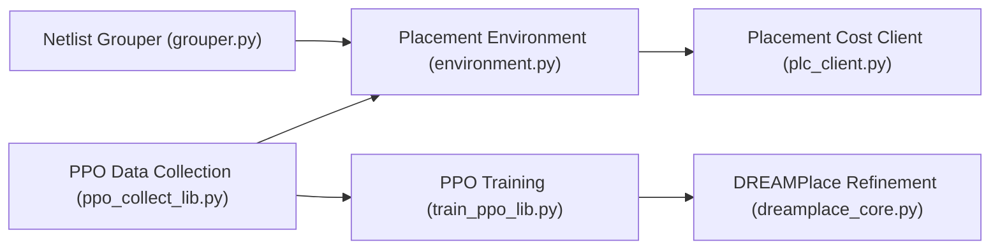

# google-research/circuit_training

> AlphaChip: distributed RL chip floorplanning framework, reproducing the 2021 Nature paper.

## The problem
Placing macros on a chip while optimizing wire length, congestion and density takes designers weeks.

## What it actually does
Groups netlists into clusters, exposes a placement environment (cost computed by an external binary), trains a PPO agent with a graph neural network using distributed collection (TF-Agents, Reverb), then can refine standard cells with DREAMPlace. Handles fixed macros, orientation, alignment and spacing constraints.

## How it is wired


## Trying it
```bash
export CT_VERSION=0.0.4
git clone https://github.com/google-research/circuit_training.git
git -C $(pwd)/circuit_training checkout r${CT_VERSION}
docker build --pull --no-cache --tag circuit_training:core -f "${REPO_ROOT}"/tools/docker/ubuntu_circuit_training ${REPO_ROOT}/tools/docker/
bash tools/e2e_smoke_test.sh --root_dir /workspace/logs
```

## Cost and gotchas
Linux only, Python 3.9, no PyPI package. DREAMPlace must be compiled or taken as a provided binary; branches age with TF-Agents. The smoke test takes 10 to 20 minutes.

## What it is not
Not a ready-to-use EDA tool: a research project, not an official Google product. The full pre-trained model is not shared, only a checkpoint on 20 TPU blocks is.

## Alternatives
No alternative named in the README.

## For you
Worth watching: interesting as a textbook case of industrial RL, but with no direct use outside chip design.
