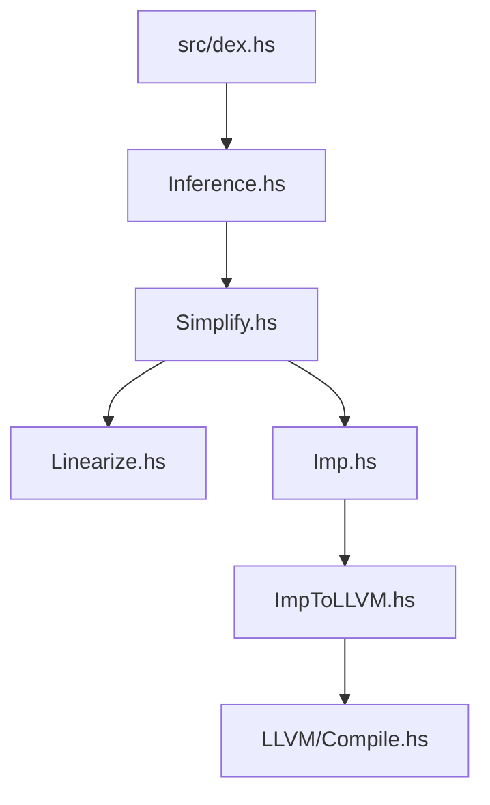

# google-research/dex-lang

> Typed, functional research language for array computing, with automatic differentiation.

## The problem
Array computing languages like NumPy type indices poorly and handle differentiation poorly.

## What it actually does
Dex reads the code, parses it, infers types, simplifies, then automatically differentiates (Linearize) before lowering to Imp, translating to LLVM and compiling. It provides a REPL, scripts, a web notebook and a Python API. Examples: Mandelbrot, Hamiltonian Monte Carlo, ODE integrator, molecular simulation.

## How it is wired


## Trying it
```bash
make install
dex repl
dex script examples/pi.dx
dex web examples/pi.dx
```

## Cost and gotchas
Free. Requires Stack (Haskell), LLVM 12, clang 12 and libpng. The README warns: early research project, "monstrous bugs". Last push in January 2026.

## What it is not
It is not a production-ready competitor to JAX or PyTorch.

## Alternatives
No alternative named in the README.

## For you
Worth watching: interesting ideas on array typing and differentiation for research, but heavy tooling and an exploratory project.
