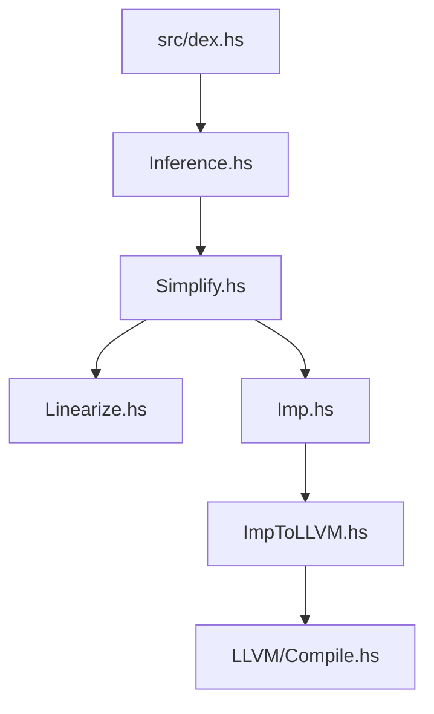

# google-research/dex-lang

> Langage de recherche typé et fonctionnel pour le calcul sur tableaux, avec différentiation automatique.

## Le problème
Les langages de calcul sur tableaux comme NumPy typent mal les indices et gèrent mal la différentiation.

## Ce que ça fait vraiment
Dex lit le code, le découpe, infère les types, simplifie puis dérive automatiquement (Linearize) avant de descendre en Imp, de traduire en LLVM et de compiler. Il fournit REPL, scripts, notebook web et une API Python. Des exemples : Mandelbrot, Monte-Carlo hamiltonien, intégrateur d'EDO, simulation moléculaire.

## Comment c'est branché


## Essayer
```bash
make install
dex repl
dex script examples/pi.dx
dex web examples/pi.dx
```

## Coût et pièges
Gratuit. Il faut Stack (Haskell), LLVM 12, clang 12 et libpng. Le README prévient : projet de recherche précoce, « bugs monstrueux ». Dernier push en janvier 2026.

## Ce que ce n'est pas
Ce n'est pas un concurrent prêt pour la production de JAX ou PyTorch.

## Alternatives
Aucune alternative nommée dans le README.

## Pour toi
À surveiller : idées de typage des tableaux et de différentiation intéressantes pour la recherche, mais outillage lourd et projet exploratoire.

