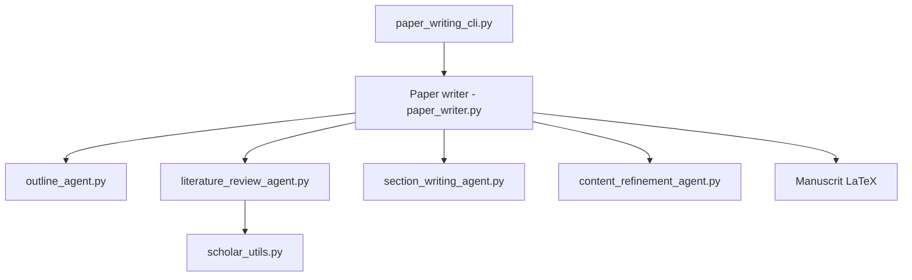

# google-research/paper-orchestra

> Multi-agent pipeline that turns experiment notes and logs into a LaTeX manuscript of a scientific paper.

## The problem
Going from raw ideas and results to a paper formatted for a conference (outline, bibliography, sections, figures) takes a long time.

## What it actually does
A CLI and a Streamlit demo launch an orchestrator that chains agents: outline, literature review via Semantic Scholar, section writing, refinement guided by an automatic review, and optionally figure generation. It produces LaTeX following conference templates. The dataset is not provided (later release announced).

## How it is wired


## Trying it
```bash
conda create -n paper_orchestra python=3.11
conda activate paper_orchestra
pip install -r requirements.txt
./paper_writing_cli.sh
python paper_writing_cli.py --raw_materials_dir /path_to_your_raw_materials/ \
  --latex_template_dir /path_to_your_latex_template/ \
  --output_dir /path_to_your_output_folder/ --use_plotting true
```

## Cost and gotchas
Keys to provide in `.env`: Semantic Scholar, Gemini (or Vertex AI) or OpenAI. Each paper triggers many model calls, hence a variable bill. SMTP credentials are optional for the demo.

## What it is not
Not an official Google product (explicitly stated). Guarantees neither the accuracy of references nor scientific quality: human review is mandatory.

## Alternatives
No alternative named in the README.

## For you
Worth watching as a reference multi-agent writing pipeline; usable for research, without the evaluation dataset.
