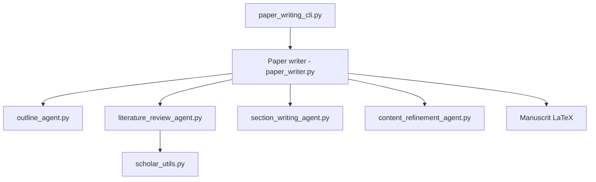

# google-research/paper-orchestra

> Pipeline multi-agents qui transforme des notes et logs d'expériences en manuscrit LaTeX d'article scientifique.

## Le problème
Passer d'idées et de résultats bruts à un article formaté pour une conférence (plan, bibliographie, sections, figures) est long.

## Ce que ça fait vraiment
Une CLI et une démo Streamlit lancent un orchestrateur qui enchaîne des agents : plan, revue de littérature via Semantic Scholar, rédaction de sections, raffinement guidé par une revue automatique, et en option génération de figures. Il produit du LaTeX selon des gabarits de conférence. Le jeu de données n'est pas fourni (publication ultérieure annoncée).

## Comment c'est branché


## Essayer
```bash
conda create -n paper_orchestra python=3.11
conda activate paper_orchestra
pip install -r requirements.txt
./paper_writing_cli.sh
python paper_writing_cli.py --raw_materials_dir /path_to_your_raw_materials/ \
  --latex_template_dir /path_to_your_latex_template/ \
  --output_dir /path_to_your_output_folder/ --use_plotting true
```

## Coût et pièges
Clés à fournir dans `.env` : Semantic Scholar, Gemini (ou Vertex AI) ou OpenAI. Chaque article déclenche de nombreux appels de modèles, donc une facture variable. Les identifiants SMTP sont optionnels pour la démo.

## Ce que ce n'est pas
Pas un produit Google officiel (mention explicite). Ne garantit ni exactitude des références ni qualité scientifique : relecture humaine obligatoire.

## Alternatives
Aucune alternative nommée dans le README.

## Pour toi
À surveiller comme référence de pipeline multi-agents de rédaction ; utilisable en recherche, sans le jeu de données d'évaluation.

