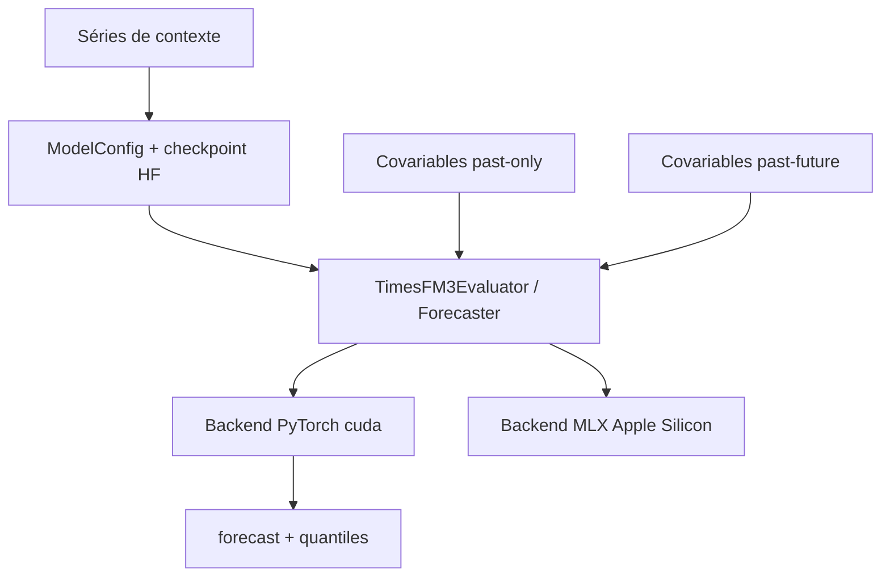

# google-research/timesfm

> Pretrained foundation model from Google Research for time series forecasting.

## The problem
Forecasting a time series means training one model per series, or close to it, and redoing the tuning for every dataset.
Covariates and multivariate data often force a complete change of approach.

## What it actually does
Pretrained decoder-only model for forecasting, usable zero-shot; current version 3.0, checkpoint `google/timesfm-3.0-pytorch`.
Version 3.0 brings native multivariate support and covariates, past-only or past-and-future, without per-task tuning.
`predict` / `predict_batch` API: a list of 1D series of varying lengths, or a 2D array `(num_variates, context_length)`, with a median prediction and 9 quantiles.
Native MLX backend for Apple Silicon, numerically aligned with PyTorch (max error around 1e-6), a LoRA fine-tuning example via Transformers + PEFT, unit tests and a `SKILL.md` for agents.

## How it is wired


## Trying it
```shell
pip install timesfm[torch]
pip install timesfm[mlx]
```

```shell
git clone https://github.com/google-research/timesfm.git
cd timesfm
uv venv && source .venv/bin/activate
uv pip install -e .[torch]
```

## Cost and gotchas
Free; the examples use `device="cuda"`, so a GPU is expected on the PyTorch side (the MLX backend does without one on Apple Silicon).
Contexts longer than `global_context` (15,360) are silently truncated to the most recent points.

## What it is not
It is not an officially supported Google product: the README says so explicitly for this open version.
It is not a complete forecasting pipeline: no data preparation, seasonality detection or monitoring.
The announced benchmark rankings (fev-bench, TIME, GIFT-Eval) are reported by the project itself.

## Alternatives
No alternative is named in the README; it cites Google integrations (BigQuery ML, Sheets, Vertex Model Garden).

## For you
The first reflex to have on a new time series: a zero-shot baseline before training anything.
