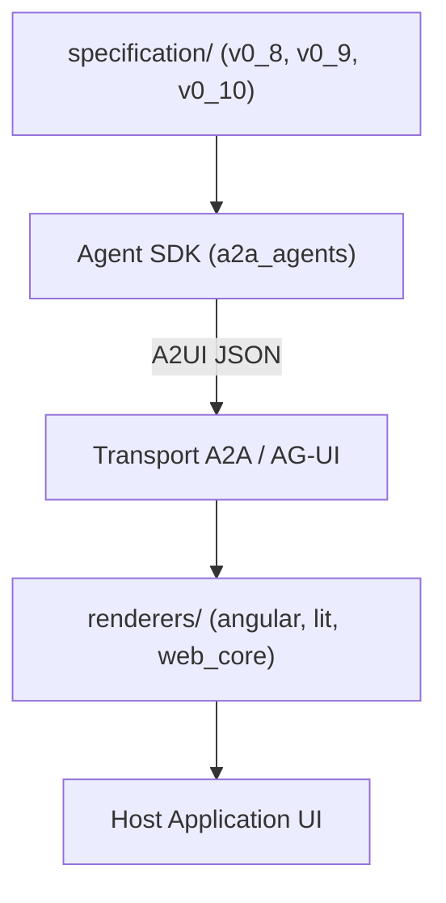

# google/A2UI

> Declarative JSON format and renderers so that agents generate safe interfaces.

## The problem
A remote agent cannot send executable code to a client application, but must be able to present a rich interface.

## What it actually does
The agent sends JSON describing the UI intent; the client renders it with its own catalog of approved components (Flutter, Angular, Lit, React, SwiftUI). The component list is flat, with references by identifier, so it can be generated progressively. Transport goes through A2A or AG-UI. Python, TypeScript, Dart and Swift packages; some "Not published yet".

## How it is wired


## Trying it
```bash
git clone https://github.com/a2ui-project/a2ui.git
cd a2ui
export GEMINI_API_KEY="your_gemini_api_key"
corepack enable
yarn install
cd samples/client/lit
yarn demo:restaurant
npm install @a2ui/react
```

## Cost and gotchas
The demo requires a Gemini API key, Node.js 18+ and uv. Several packages are not yet published; support covers Web or Flutter.

## What it is not
Not an agent framework. The README says a React chat alone can do without it: it mainly serves cross-platform use or remote agents.

## Alternatives
- AG-UI: compatible transport, with scaffolding via create-ag-ui-app.
- genui: Flutter package replaced by a2ui_flutter.

## For you
Watch: relevant if you build remote agents with generated interfaces; the project moves fast and several packages are still to come.
