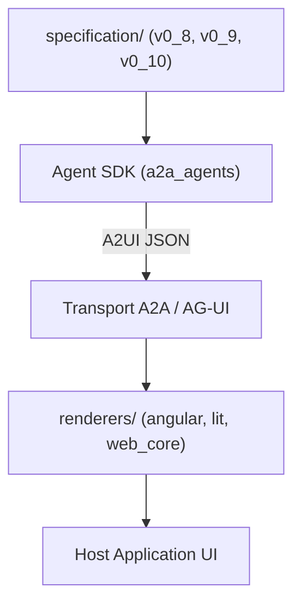

# google/A2UI

> Format déclaratif JSON et moteurs de rendu pour que des agents génèrent des interfaces sûres.

## Le problème
Un agent distant ne peut pas envoyer de code exécutable à une application cliente, mais doit pouvoir présenter une interface riche.

## Ce que ça fait vraiment
L'agent envoie du JSON décrivant l'intention de l'UI ; le client la rend avec son propre catalogue de composants approuvés (Flutter, Angular, Lit, React, SwiftUI). La liste de composants est plate, avec des références par identifiant, pour être générée progressivement. Le transport passe par A2A ou AG-UI. Paquets Python, TypeScript, Dart et Swift ; certains « Not published yet ».

## Comment c'est branché


## Essayer
```bash
git clone https://github.com/a2ui-project/a2ui.git
cd a2ui
export GEMINI_API_KEY="your_gemini_api_key"
corepack enable
yarn install
cd samples/client/lit
yarn demo:restaurant
npm install @a2ui/react
```

## Coût et pièges
La démo demande une clé d'API Gemini, Node.js 18+ et uv. Plusieurs paquets ne sont pas encore publiés ; la prise en charge couvre Web ou Flutter.

## Ce que ce n'est pas
Pas un framework d'agents. Le README dit qu'un chat React seul peut s'en passer : il sert surtout au multiplateforme ou aux agents distants.

## Alternatives
- AG-UI : transport compatible, avec scaffolding via create-ag-ui-app.
- genui : paquet Flutter remplacé par a2ui_flutter.

## Pour toi
Surveiller : pertinent si tu fais des agents distants à interface générée ; le projet bouge vite et plusieurs paquets sont à venir.

