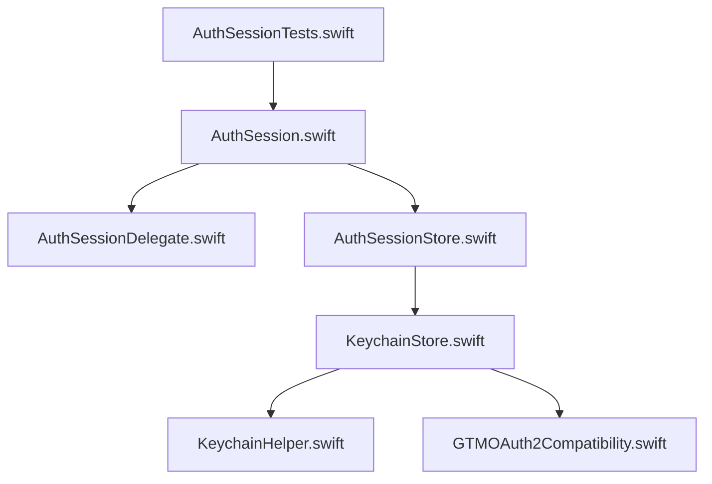

# google/GTMAppAuth

> Apple library (iOS, macOS, tvOS, watchOS) that authorizes Google requests through AppAuth and the browser.

## The problem
GTMOAuth2 used an embedded web view, which was less secure and did not reuse the browser session.

## What it actually does
`AuthSession` authorizes Session Fetcher requests with AppAuth tokens (PKCE if the server supports it). `KeychainStore` saves the session in the keychain, with data protection by default on macOS. Compatibility methods migrate existing GTMOAuth2 authorizations without a new sign-in.

## How it is wired


## Trying it
```bash
# Podfile : pod 'GTMAppAuth'
pod install
```

## Cost and gotchas
Version 6.0.0: iOS 15+, macOS 12+, depends on AppAuth 3.x. You must register an "iOS" type OAuth client with Google. Projects on iOS 12 to 14 stay on 5.x.

## What it is not
Not an Android or server library. It does not replace AppAuth; it plugs into it.

## Alternatives
GTMOAuth2: the old authorizer, to be migrated according to the README.

## For you
Ignore: reserved for Apple app development, unrelated to data or AI.
