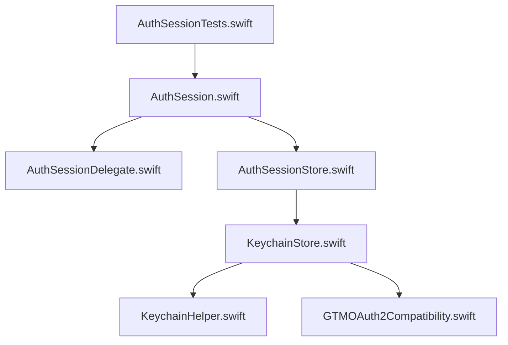

# google/GTMAppAuth

> Bibliothèque Apple (iOS, macOS, tvOS, watchOS) qui autorise les requêtes Google via AppAuth et le navigateur.

## Le problème
GTMOAuth2 utilisait une vue web intégrée, moins sûre et sans réutilisation de la session du navigateur.

## Ce que ça fait vraiment
`AuthSession` autorise les requêtes du Session Fetcher avec les jetons AppAuth (PKCE si le serveur le gère). `KeychainStore` enregistre la session dans le trousseau, avec protection des données par défaut sur macOS. Des méthodes de compatibilité migrent les autorisations GTMOAuth2 existantes sans nouvelle connexion.

## Comment c'est branché


## Essayer
```bash
# Podfile : pod 'GTMAppAuth'
pod install
```

## Coût et pièges
Version 6.0.0 : iOS 15+, macOS 12+, dépend d'AppAuth 3.x. Il faut enregistrer un client OAuth de type « iOS » chez Google. Les projets sur iOS 12 à 14 restent en 5.x.

## Ce que ce n'est pas
Pas une bibliothèque Android ni serveur. Ne remplace pas AppAuth, elle s'y greffe.

## Alternatives
GTMOAuth2 : l'ancien autorisateur, à migrer selon le README.

## Pour toi
Ignorer : réservé au développement d'applications Apple, sans lien avec la data ou l'IA.

