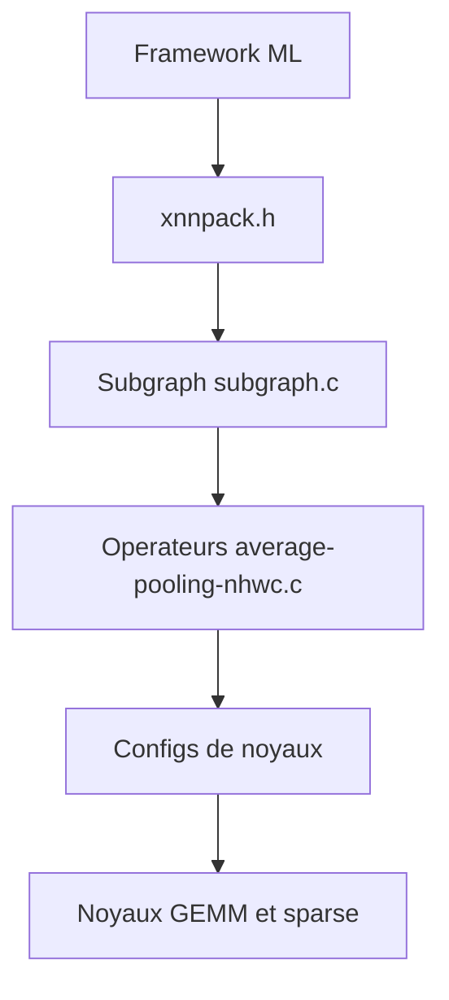

# google/XNNPACK

> C library of optimized neural network operators, for inference frameworks on ARM, x86, WebAssembly and RISC-V.

## The problem
Mobile and web inference frameworks need fast compute kernels on CPU, written for each architecture.

## What it actually does
Provides operators (convolutions, pooling, activations, quantization, softmax...) in NHWC layout, with a custom stride on channels. Used by TensorFlow Lite, TensorFlow.js, PyTorch Mobile, ONNX Runtime, MediaPipe. The README gives measurements on Pixel and Raspberry Pi with MobileNet.

## How it is wired

## Trying it
No command in the README; it only states the build prerequisites: C11, C++17, Python 3. A `./scripts/build-local.sh` script is cited for the Raspberry Pi measurements.

## Cost and gotchas
Free. C/C++ compilation required. A license is present but not identified by GitHub: to be checked. 535 open issues.

## What it is not
Not meant for direct use by deep learning researchers or practitioners: it is a low-level building block for frameworks. The measurements date from 2020 and 2022.

## Alternatives
No alternative named in the README (it lists frameworks that use it).

## For you
Keep an eye on it: you already benefit from it through TFLite or ONNX Runtime; integrate it directly only for custom embedded CPU inference.
