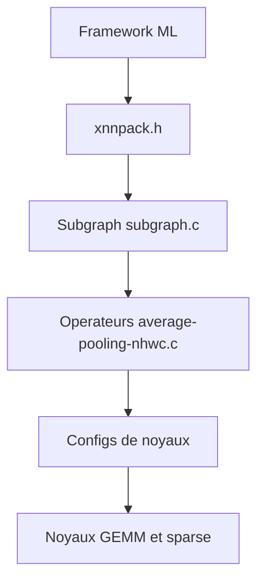

# google/XNNPACK

> Bibliothèque C d'opérateurs de réseaux de neurones optimisés, pour les frameworks d'inférence sur ARM, x86, WebAssembly et RISC-V.

## Le problème
Les frameworks d'inférence mobile et web ont besoin de noyaux de calcul rapides sur CPU, écrits pour chaque architecture.

## Ce que ça fait vraiment
Fournit des opérateurs (convolutions, pooling, activations, quantification, softmax...) en disposition NHWC, avec pas personnalisé sur les canaux. Utilisée par TensorFlow Lite, TensorFlow.js, PyTorch Mobile, ONNX Runtime, MediaPipe. Le README donne des mesures sur Pixel et Raspberry Pi avec MobileNet.

## Comment c'est branché

## Essayer
Aucune commande dans le README ; il indique seulement les prérequis de compilation : C11, C++17, Python 3. Un script `./scripts/build-local.sh` est cité pour les mesures sur Raspberry Pi.

## Coût et pièges
Gratuit. Compilation C/C++ nécessaire. Licence présente mais non identifiée par GitHub : à vérifier. 535 issues ouvertes.

## Ce que ce n'est pas
Pas fait pour un usage direct par les chercheurs ou praticiens du deep learning : c'est une brique de bas niveau pour frameworks. Les mesures datent de 2020 et 2022.

## Alternatives
Aucune alternative nommée dans le README (il liste des frameworks qui l'utilisent).

## Pour toi
À surveiller : tu en profites déjà via TFLite ou ONNX Runtime ; ne l'intègre en direct que pour de l'inférence CPU embarquée sur mesure.

