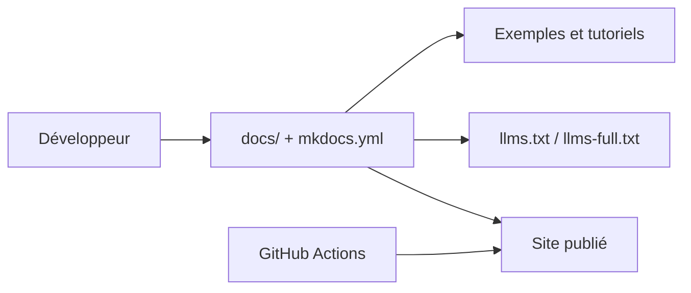

# google/adk-docs

> Documentation repository for Agent Development Kit, a code-first toolkit for AI agents.

## The problem
Building multi-step agents requires a clear structure (tools, orchestration, evaluation, deployment) rather than a pile of scripts.

## What it actually does
The README presents ADK as a modular framework, agnostic to model and deployment, optimized for Gemini. It points to the Python, TypeScript, Go, Java and Kotlin guides, and provides `llms.txt` and `llms-full.txt` to give the documentation to code assistants. The repository itself contains the documentation site, not the framework.

## How it is wired

## Trying it
No command documented in the README: it points to the getting-started guides for each language.

## Cost and gotchas
Free for the docs. Using ADK implies the models and services you choose (Gemini, Cloud Run, GKE, Agent Runtime) and their costs; the README details none of them.

## What it is not
Not the ADK code: it is the documentation repository. The architecture description provided describes the library, whereas the repository mostly contains pages and the publishing pipeline.

## Alternatives
No alternative named in the README.

## For you
Worth watching: a reference source for designing agents, to read if you are evaluating ADK; the tool itself is in other repositories.
