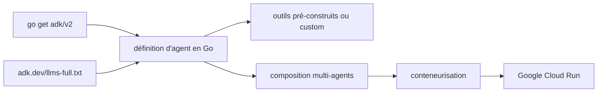

# google/adk-go

> Google's Go toolkit for building, evaluating and deploying AI agents.

## The problem
Writing an agent in Go means recoding orchestration, tools and evaluation, without the building blocks available on the Python side.

## What it actually does
Provides a modular framework that applies software development principles to building agents.
Agent logic, tools and orchestration defined directly in Go, for testability and versioning.
Multi-agent systems by composition of specialized agents.
Optimized for Gemini but advertised as agnostic to the model, the deployment and other frameworks.

## How it is wired


## Trying it
```bash
go get google.golang.org/adk/v2
```

## Cost and gotchas
A model is needed: optimized for Gemini, so an API key at your expense. The README says nothing about quotas or costs. Nothing indicates which building blocks are stable.

## What it is not
The README shows no code example: it points to `adk.dev/llms.txt` and `llms-full.txt`, two indexes designed to be given to a coding agent rather than read. No description of the concepts (tools, sessions, evaluation) in the repository itself. Not the reference version: it is the Go port of an existing ADK.

## Alternatives
No alternative named in the README.

## For you
Worth watching only if your agent stack is in Go; otherwise, the Python version of the same ADK is better documented.
