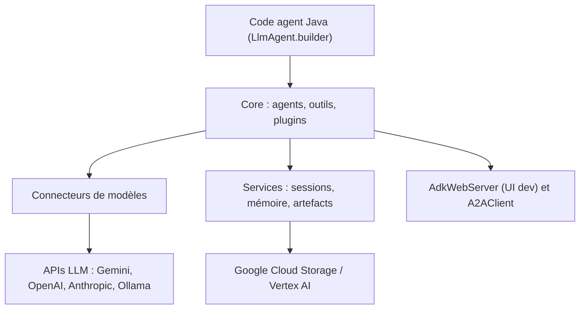

# google/adk-java

> Code-first Java toolkit for building AI agents and orchestrating them into teams.

## The problem
Building agents with tools and sub-agents in Java forces you to assemble orchestration, sessions and model calls yourself, while the agent ecosystem is mostly Python.

## What it actually does
The kit provides agents (LlmAgent, LoopAgent, etc.) with a fluent builder, a framework of tools and plugins (ready-made tools, functions, OpenAPI), session, memory and artifact services, and model connectors. A web development interface lets you test and debug. A2A integration enables communication between remote agents. The "evaluation" part is announced as "Coming soon".

## How it is wired


## Trying it
```bash
# Dépendance Maven (version indiquée dans le README : 1.14.0)
# com.google.adk:google-adk  et  com.google.adk:google-adk-dev (interface de dev)
# Aucune commande shell documentée
```

## Cost and gotchas
The README shows the gemini-2.0-flash model: you need an API key or a Google Cloud account depending on the provider, billed to you. Pre-GA features are provided "as is", with limited support.

## What it is not
It is not a hosted service nor an evaluation framework ("Coming soon"). It is designed for tight integration with Google Cloud, even though other models are reachable.

## Alternatives
- Python ADK: same interface, more complete, the README refers to it as the model.

## For you
Keep an eye on it: relevant only if your agent stack is in Java and Google Cloud oriented; in Python, the original ADK is the natural choice.
