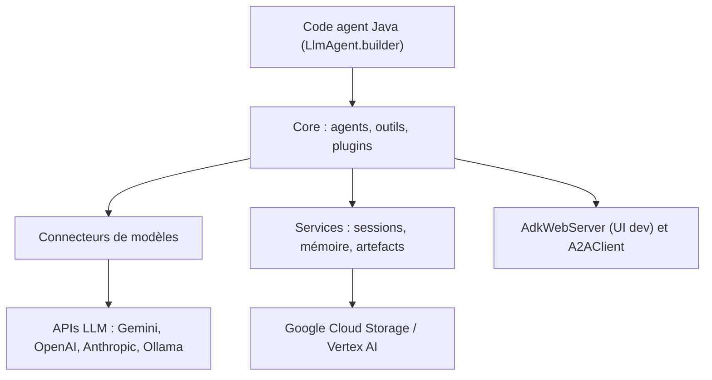

# google/adk-java

> Boîte à outils Java, code d'abord, pour construire des agents IA et les orchestrer en équipes.

## Le problème
Construire des agents avec outils et sous-agents en Java oblige à assembler soi-même orchestration, sessions et appels de modèles, alors que l'écosystème agents est surtout Python.

## Ce que ça fait vraiment
Le kit fournit des agents (LlmAgent, LoopAgent, etc.) avec constructeur fluide, un cadre d'outils et de plugins (outils prêts à l'emploi, fonctions, OpenAPI), des services de session, mémoire et artefacts, et des connecteurs de modèles. Une interface web de développement permet de tester et déboguer. L'intégration A2A permet la communication entre agents distants. La partie « évaluation » est annoncée « Coming soon ».

## Comment c'est branché


## Essayer
```bash
# Dépendance Maven (version indiquée dans le README : 1.14.0)
# com.google.adk:google-adk  et  com.google.adk:google-adk-dev (interface de dev)
# Aucune commande shell documentée
```

## Coût et pièges
Le README montre le modèle gemini-2.0-flash : il faut une clé d'API ou un compte Google Cloud selon le fournisseur, facturés à ta charge. Les fonctions Pre-GA sont fournies « as is », avec support limité.

## Ce que ce n'est pas
Ce n'est pas un service hébergé ni un framework d'évaluation (« Coming soon »). Il est pensé pour une intégration étroite avec Google Cloud, même si d'autres modèles sont accessibles.

## Alternatives
- Python ADK : même interface, plus complet, le README s'y réfère comme au modèle.

## Pour toi
À surveiller : pertinent seulement si ta stack agents est en Java et orientée Google Cloud ; en Python, l'ADK d'origine est le choix naturel.

