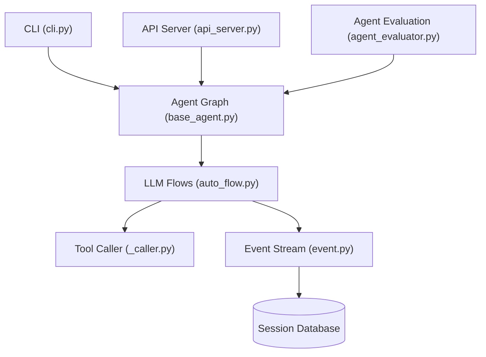

# google/adk-python

> Google's Python framework for building, evaluating and deploying AI agents and their graph workflows.

## The problem
Assembling agents, their tools, their memory and their evaluation by hand yields ad hoc code that is hard to test and deploy.

## What it actually does
Provides the `Agent` and `Workflow` classes (execution graph with routing, loops, resumption, human validation). The runtime loads the agent graph, runs LLM flows, calls tools or delegates to other agents, then persists sessions and artifacts. A CLI (`adk run`, `adk eval`, `adk deploy`) and a development UI complete the set. Optimized for Gemini but presented as model-agnostic.

## How it is wired


## Trying it
```bash
pip install google-adk
adk run path/to/my_agent
adk eval \
    contributing/samples/evaluation/home_automation_agent \
    contributing/samples/evaluation/basic_criteria/home_automation.evalset.json \
    --config_file_path contributing/samples/evaluation/basic_criteria/eval_config.json
```

## Cost and gotchas
Python 3.11+ required. A model (Gemini by default in the example) requires an API key or a cloud account at your expense. The development version installed from `main` may contain experimental changes.

## What it is not
Not a ready-to-use agent: it is a construction kit. Several building blocks (RAG, search, code engine, telemetry) rely on Google Cloud services (Vertex). Deployment mainly targets Cloud Run and Vertex AI Agent Engine, although Docker is possible.

## Alternatives
No alternative named in the README.

## For you
Worth watching: a serious base for agents with built-in evaluation, but the Google/Gemini center of gravity ties you to that ecosystem if you are not already in it.
