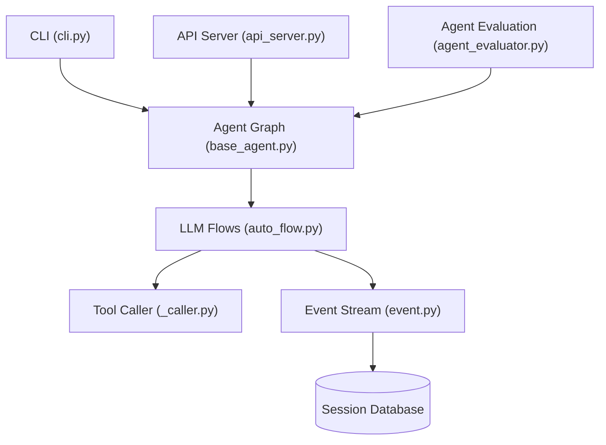

# google/adk-python

> Framework Python de Google pour construire, évaluer et déployer des agents IA et leurs workflows en graphe.

## Le problème
Assembler des agents, leurs outils, leur mémoire et leur évaluation à la main donne du code ad hoc, difficile à tester et à déployer.

## Ce que ça fait vraiment
Fournit les classes `Agent` et `Workflow` (graphe d'exécution avec routage, boucles, reprise, validation humaine). Le runtime charge le graphe d'agents, exécute les flux LLM, appelle les outils ou délègue à d'autres agents, puis persiste sessions et artefacts. Une CLI (`adk run`, `adk eval`, `adk deploy`) et une UI de développement complètent l'ensemble. Optimisé pour Gemini mais présenté comme agnostique du modèle.

## Comment c'est branché


## Essayer
```bash
pip install google-adk
adk run path/to/my_agent
adk eval \
    contributing/samples/evaluation/home_automation_agent \
    contributing/samples/evaluation/basic_criteria/home_automation.evalset.json \
    --config_file_path contributing/samples/evaluation/basic_criteria/eval_config.json
```

## Coût et pièges
Python 3.11+ requis. Un modèle (Gemini par défaut dans l'exemple) suppose une clé d'API ou un compte cloud à ta charge. La version de développement installée depuis `main` peut contenir des changements expérimentaux.

## Ce que ce n'est pas
Pas un agent prêt à l'emploi : c'est un kit de construction. Plusieurs briques (RAG, recherche, moteur de code, télémétrie) s'appuient sur des services Google Cloud (Vertex). Le déploiement cible surtout Cloud Run et Vertex AI Agent Engine, même si Docker est possible.

## Alternatives
Aucune alternative nommée dans le README.

## Pour toi
À surveiller : base sérieuse pour des agents avec évaluation intégrée, mais le centre de gravité Google/Gemini te lie à cet écosystème si tu n'y es pas déjà.

