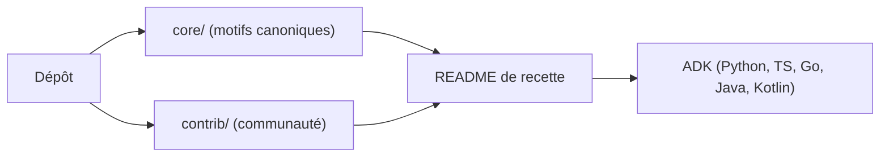

# google/adk-samples

> Public collection of runnable ADK agent recipes, to fork as a starting point.

## The problem
Starting an agent with the Agent Development Kit from a blank page is slow without concrete examples.

## What it actually does
Recipes in two folders: `core/` (canonical patterns: OAuth, session memory, guardrails, RAG) and `contrib/` (community contributions by use case). Each recipe has its own installation README. The README cites the ADK SDKs for Python, TypeScript, Go, Java and Kotlin. The diagram provided, written in Chinese, describes an older `java/agents` and `python/agents` layout (bug assistant, time-series forecasting, academic research, etc.) that does not match the README.

## How it is wired

## Trying it
No command documented in the README: install ADK following its guide, then follow each recipe's README.

## Cost and gotchas
A model or API key is probably needed depending on the recipe, not specified here. The README states an unofficially supported product, outside Google's vulnerability reward program.

## What it is not
Not a product or a base for production: "for demonstration and as starting points, not production use". Inconsistency between README and diagram: the actual content of the recipes cannot be verified here.

## Alternatives
No alternative named in the README.

## For you
Keep an eye on it: a good reservoir of examples if you build agents with ADK, but short README and no official support.
