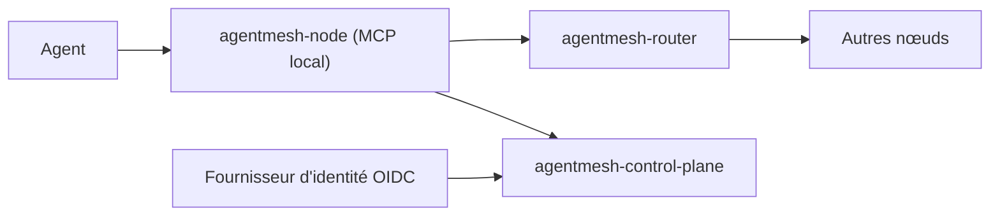

# google/agentmesh

> Private network for AI agents: publish, discover and call tools and models with verifiable identity.

## The problem
Agents spread across laptops, containers and clusters behind NAT can neither discover each other nor authenticate.

## What it actually does
An `agentmesh-node` runs next to the agent, publishes local services, calls those of other nodes and exposes a local MCP server plus an OpenAI-compatible endpoint. A control plane issues short-lived credentials bound to the node's key (OIDC token or bootstrap token). A router relays when the direct connection fails. Nothing is reachable by default; permissions apply to service names.

## How it is wired


## Trying it
```bash
curl -sL https://google.github.io/agentmesh/install.sh | bash
agentmesh-node join https://bananas.sam-mesh.dev
agentmesh-node run --daemonize
agentmesh-node skill install
```

## Cost and gotchas
Free. The shared trial network has no availability promise. A `curl | bash` to review. Sandboxed agents and mobile app in preview.

## What it is not
Not yet at version 1.0; not a Google product with guaranteed support: the README says it is pre-1.0.

## Alternatives
No alternative named in the README.

## For you
Worth watching: interesting for linking agents across machines with explicit permissions, but young and to be tested on the trial network.
