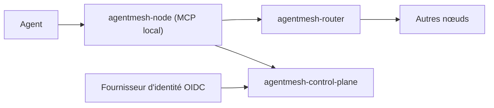

# google/agentmesh

> Réseau privé pour agents IA : publier, découvrir et appeler des outils et modèles avec identité vérifiable.

## Le problème
Des agents répartis sur portables, conteneurs et clusters derrière NAT ne savent ni se découvrir ni s'authentifier.

## Ce que ça fait vraiment
Un nœud `agentmesh-node` tourne près de l'agent, publie des services locaux, appelle ceux des autres nœuds et expose un serveur MCP local plus un point d'accès compatible OpenAI. Un plan de contrôle délivre des identifiants courts liés à la clé du nœud (jeton OIDC ou jeton d'amorçage). Un routeur relaie quand la connexion directe échoue. Rien n'est joignable par défaut ; les droits portent sur des noms de service.

## Comment c'est branché


## Essayer
```bash
curl -sL https://google.github.io/agentmesh/install.sh | bash
agentmesh-node join https://bananas.sam-mesh.dev
agentmesh-node run --daemonize
agentmesh-node skill install
```

## Coût et pièges
Gratuit. Le réseau d'essai partagé n'a aucune promesse de disponibilité. Un `curl | bash` à relire. Agents bac à sable et appli mobile en préversion.

## Ce que ce n'est pas
Pas encore en version 1.0 ; pas un produit Google support garanti : le README le dit pré-1.0.

## Alternatives
Aucune alternative nommée dans le README.

## Pour toi
À surveiller : intéressant pour relier des agents entre machines avec droits explicites, mais jeune et à tester en réseau d'essai.

