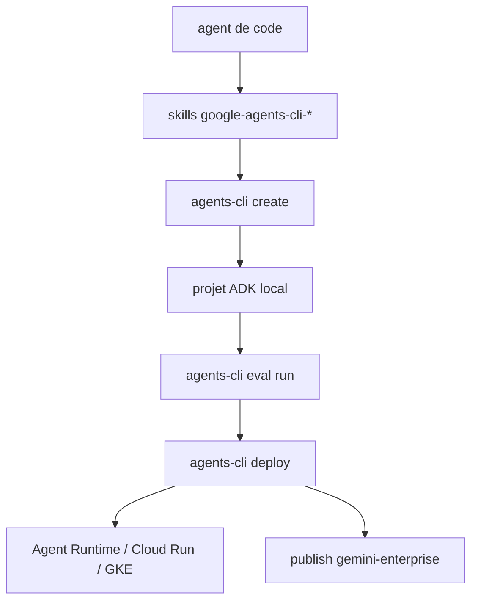

# google/agents-cli

> CLI and skills that teach your coding agent to ship ADK agents on Google Cloud.

## The problem
Building an ADK agent and deploying it requires knowing a stack of Google Cloud services, each with its own CLI and conventions.
A coding assistant left to itself invents the deployment and evaluation commands.

## What it actually does
Seven skills (`workflow`, `adk-code`, `scaffold`, `eval`, `deploy`, `publish`, `observability`) inject the ADK conventions into Claude Code, Codex or Antigravity.
The CLI itself covers the lifecycle: `create` scaffolds a project, `run` executes it on a prompt, `eval run` replays a dataset and scores the traces.
`eval` goes further than a smoke test: multi-turn scenario synthesis, comparison of two runs, clustering of failure modes, prompt auto-tuning.
`deploy` targets Agent Runtime, Cloud Run or GKE, and `publish gemini-enterprise` registers the agent in the enterprise catalog.

## How it is wired


## Trying it
```bash
uvx google-agents-cli setup
# ou seulement les skills :
npx skills add google/agents-cli
```

## Cost and gotchas
The local part (`create`, `run`, `eval`) runs with a simple AI Studio key; as soon as you `deploy`, you provision resources in your own Google Cloud project and pay for them.
Cumulative prerequisites: Python 3.11+, uv and Node.js. No license is stated in the README.

## What it is not
It is not a coding agent — the README says so explicitly, it is a tool *for* an agent. Nor is it a replacement for ADK, which remains the underlying framework.
And it is not portable: half of the value is tied to Google Cloud and Gemini Enterprise.

## Alternatives
- `agent-skills`: cited by the README for general engineering workflows (ideation, review), not agent deployment.
- `google/skills`: Google Cloud foundations (BigQuery, Cloud Run, Firebase, GKE) if your need is infrastructure rather than the agent.
- ADK alone: sufficient if you do not need the eval/deployment chain.

## For you
Relevant only if your production is on Google Cloud; the `eval` part (failure clustering, prompt optimization) is the only one reusable elsewhere.
