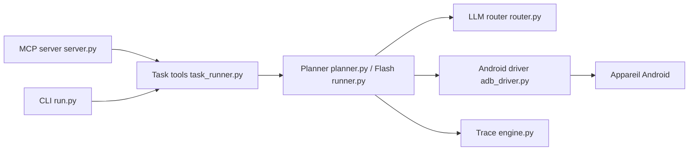

# google/artemis

> Agent that drives real Android phones in natural language, for mobile testing and IDE assistants via MCP.

## The problem
Testing or using an Android application requires scripting every screen; an agent must see the interface and act like a human.

## What it actually does
Observes the screen (accessibility tree, OCR, vision models) and acts through ADB. Two profiles: Flash (reactive loop, 3 to 5 s per step) and Pro (multi-agent graph with Planner, Operator, Checker). Exposed through CLI, web console, MCP server (for Antigravity, Claude Code, Windsurf…) and Python SDK. Installs a small accessibility service on the phone.

## How it is wired


## Trying it
```bash
git clone https://github.com/google/artemis.git && cd artemis
./start.sh
uv run artemis run "Open Settings, find Battery and tell me current level" --profile flash
uv run artemis mcp --install antigravity
```

## Cost and gotchas
The script installs ADB, scrcpy, FFmpeg and `uv` dependencies, then offers to write into your IDE configurations. You need an LLM provider (key at your expense) and a phone with USB debugging. An accessibility service is deployed on the device at the first task.

## What it is not
Not a deterministic testing framework: the result depends on the model. The "99%+ on AndroidWorld" score is a README claim, with no detailed method. Flash has no plan and no final verification.

## Alternatives
No alternative named in the README (it integrates code from Minitap's mobile-use, under Apache 2.0).

## For you
Watch: very relevant for testing mobile applications with an agent, but young (created in August 2026) and coupled to a third-party LLM.
